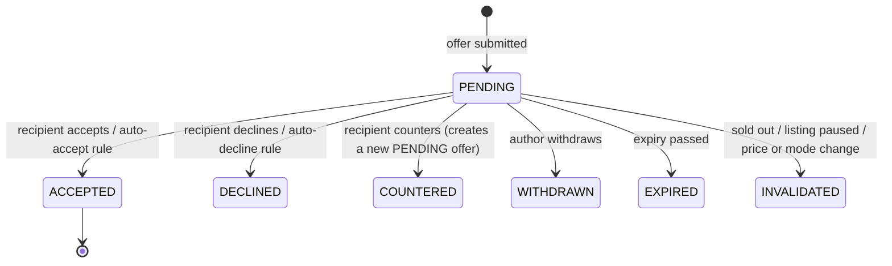
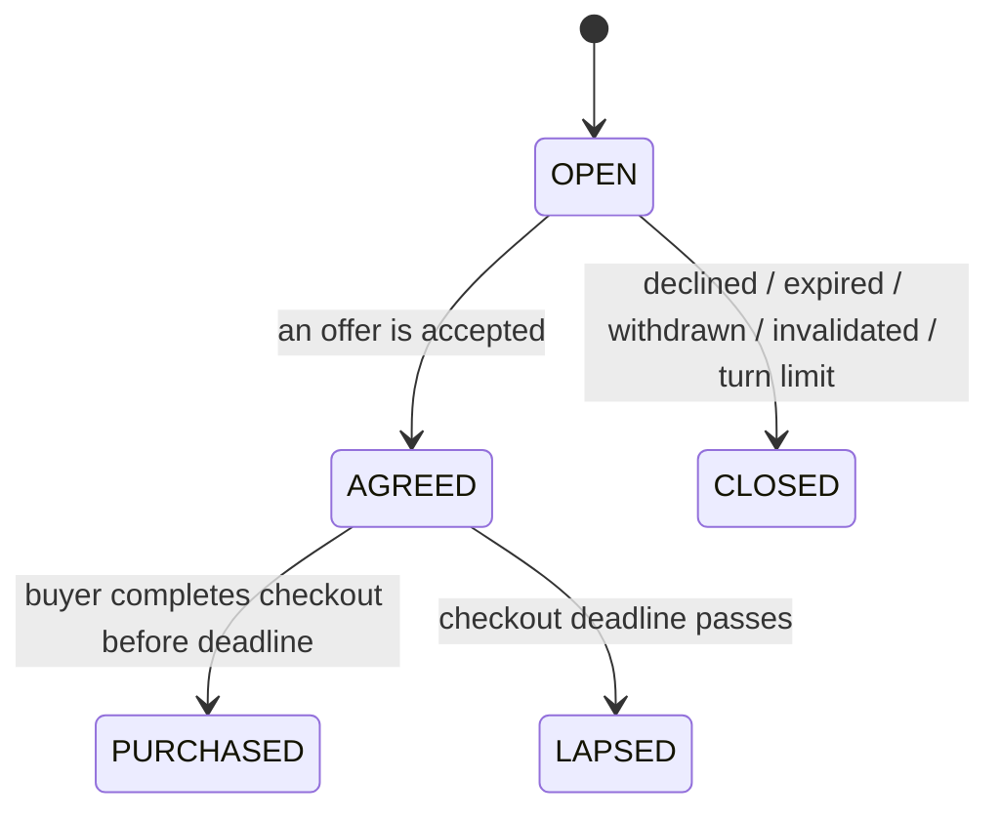

# Fayda — Project Foundation

| | |
|---|---|
| **Status** | Draft v0.1 — for founder review. Nothing here is approved until marked so. |
| **Date** | 30 October 2026 |
| **Working name** | Fayda (internal only; final brand not decided) |
| **Author** | Founding technical architect |
| **Approver** | Founder |

**Legend**
- **P0** = in the working prototype (Stage 3) · **P1** = production MVP launch (Stage 4) · **P2** = post-launch
- **[DECISION]** = needs founder approval before it becomes policy
- **[SIM]** = simulated or sandboxed in the prototype; must be visibly labelled as such
- **[PROVISIONAL]** = a proposed default I will implement in the prototype so the flow works, but which is explicitly not approved policy

---

## 0. Summary of recommendations

1. **Build the prototype as the production skeleton.** Real Expo buyer and seller apps, a real NestJS API, real PostgreSQL, and a real bargaining engine. Only external providers (SMS/OTP, media CDN, payments, push) are simulated, each behind a replaceable interface. This is the main lever for avoiding a throwaway prototype.
2. **Treat bargaining as the core domain module.** It is server-authoritative, built test-first as pure TypeScript, and isolated so confidential seller rules cannot leak into buyer responses.
3. **Use a single-item purchase model for the MVP** ("Buy now" or "Buy at agreed price"). No cart. Negotiated prices, inventory holds, and multi-seller settlement make carts expensive and risky early.
4. **Use one user identity across both apps.** A person can be a buyer, a seller, or both. Two apps remain two apps; the account is shared.
5. **Use the same media upload contract in prototype and production** (upload intent → direct upload → completion). Only the storage provider changes.
6. **Defer infrastructure**: no Redis/BullMQ, no push notifications, no admin app, and no hosted environments in the core prototype. Offer expiry uses lazy evaluation plus an in-process scheduler.
7. **Execution environment:** this chat's sandbox has **no network access**, so I cannot install dependencies or run builds and tests here. To honour "never claim it works unless verified", Stage 3 implementation should run in **Claude Code on your machine** (or in an environment with network enabled).

---

## 1. Product understanding

### 1.1 One-line definition

A video-first social-commerce marketplace where buyers discover products through reels and photos from individual and business sellers, and can buy at the listed price or negotiate through structured, seller-controlled bargaining.

### 1.2 Users

| User | Description | Primary needs |
|---|---|---|
| **Buyer** | Mobile-first shopper in Hyderabad, discovering through short video | Fast discovery, trust in seller, a fair price, simple purchase, order visibility |
| **Individual seller** | Home boutiques, Instagram/WhatsApp sellers, resellers, possibly pre-owned | Publish quickly from phone, handle many offers without chat overload, get paid |
| **Business seller** | Boutiques, small brands, retailers (likely with GSTIN) | Inventory per variant, credibility (verified badge), rules that automate bargaining, basic analytics |
| **Platform operator** | Fayda team (moderation, support, verification) | Not in prototype; required for production (admin app) |

### 1.3 Core loops

**Buyer loop:** discover (reel/photo) → engage (like, save, follow, comment) → buy now **or** make an offer → negotiate → purchase → track order → follow seller / repeat.

**Seller loop:** publish once (media + listing + price + bargaining rules) → receive attention and offers → respond manually or let private rules auto-respond → fulfil orders → review basic analytics.

### 1.4 What makes Fayda different

- **Structured bargaining** with explicit rules, turn-taking, expiry, and history, instead of free-form DMs.
- **Seller-controlled automation** (private auto-accept / auto-decline thresholds) so popular listings don't turn into negotiation overload.
- **Commerce-native video feed**: every feed item is directly purchasable or negotiable; no cross-posting to other social networks.

### 1.5 What Fayda is not (for the MVP)

- Not a chat or messaging app.
- Not an Instagram integration or cross-posting tool.
- Not a classifieds board; transactions happen on-platform.
- Not an AI recommendation product; ranking stays simple and explainable.

---

## 2. Feature inventory

Priorities are proposals. Final prototype scope is frozen after the prototype audit (Stage 2).

### 2.1 Buyer app

| Area | Feature | Priority | Notes |
|---|---|---|---|
| Account | Phone-number sign-in (OTP) | P0 [SIM] | Prototype uses a fixed dev OTP; production uses Supabase Auth phone OTP |
| Account | Profile, addresses, settings | P0 | |
| Account | Account deletion | P1 | Required by App Store and Play Store policies |
| Discovery | Vertical reel feed (autoplay, mute toggle, swipe) | P0 | Prototype plays MP4; production plays HLS from Cloudflare Stream |
| Discovery | Photo posts in feed | P0 | |
| Discovery | Feed tabs: For You (simple ranking) / Following | P0 | Rules-based ranking; no ML |
| Discovery | Text search, categories, filters (price, size, category, bargaining available) | P0 | PostgreSQL full-text + trigram |
| Product | Product detail: media gallery, price, variants, seller card, bargaining badge | P0 | |
| Seller | Seller profile, follow/unfollow, seller's listings | P0 | |
| Social | Like, save, comment (flat), native share sheet | P0 | Deep links and rich share previews are P1 |
| Social | Report content, block user | P1 | Required for UGC apps on the App Store |
| Bargaining | Make offer (private/public per listing mode) | P0 | |
| Bargaining | View, accept, decline, counter seller counteroffers; withdraw | P0 | |
| Bargaining | Public offers view on listing (anonymised) | P0 [PROVISIONAL] | Exact public visibility is an open decision (B6) |
| Bargaining | "My offers" with status, expiry countdown, history | P0 | |
| Purchase | Buy now / Buy at agreed price, address, order summary | P0 | |
| Purchase | Payment | P0 [SIM] | Simulated provider in prototype; real gateway in production (B5) |
| Orders | Order list, order detail with status timeline | P0 | |
| Orders | Cancellation, returns, refunds | P1 | Policy-dependent (B8) |
| Notifications | In-app notification centre with real-time updates | P0 | |
| Notifications | Push notifications | P1 | |

### 2.2 Seller app

| Area | Feature | Priority | Notes |
|---|---|---|---|
| Onboarding | Sign-in (shared identity), seller type: individual or business | P0 [SIM OTP] | |
| Onboarding | Seller profile: handle, name, bio, avatar, city; business name and GSTIN (optional) | P0 | GSTIN stored, not validated, in prototype |
| Onboarding | Verification / KYC | P1 | Policy-dependent (B7); prototype shows status only |
| Publishing | Single publish flow: capture/pick video and photos → details → variants and stock → price → bargaining settings → publish | P0 | Must be completable in one sitting on a phone |
| Publishing | Drafts, edit, pause, mark sold out, delete | P0 | |
| Publishing | Media processing status (uploading/processing/ready/failed) | P0 [SIM] | Simulated short processing delay so the UI handles it from day one |
| Bargaining | Per-listing mode: fixed / private / public / both | P0 | |
| Bargaining | Private rules: auto-accept at or above X, auto-decline below Y, offer expiry | P0 | Never visible to buyers |
| Negotiations | Inbox (pending, countered, agreed, closed), sorted by urgency | P0 | |
| Negotiations | Accept, decline, counter, full history | P0 | |
| Inventory | Stock per variant, availability, reserved stock visibility | P0 | |
| Orders | Order list, order detail, status updates (confirm, ship, deliver) | P0 [SIM fulfilment] | Seller marks statuses manually; logistics undecided (B3) |
| Analytics | Per-listing views, likes, saves, offers, conversions; seller totals | P0 (basic) | From the platform's own database |
| Payouts | Earnings and settlement view | P1 | Settlement model undecided (B4) |
| Notifications | In-app real-time / push | P0 / P1 | |

### 2.3 Platform and operations

| Feature | Priority | Notes |
|---|---|---|
| Seed data (Hyderabad fashion sellers, listings, media) and "reset demo" command | P0 | Dev-only; disabled outside local/demo environments |
| Visible environment banner and "Simulated" labels | P0 | |
| Admin app (Next.js): moderation, reports, seller verification, user management, order and negotiation inspection, audit log | P1 | |
| Disputes and support tooling | P1 | Policy-dependent (B8) |
| Product analytics (PostHog), error monitoring (Sentry), tracing (OpenTelemetry) | P1 | Prototype uses structured logs only |

---

## 3. Bargaining domain model

This is the most important business logic in the product. It is specified here so it can be reviewed before any code exists.

### 3.1 Listing bargaining modes

> **Superseded 31 Oct 2026 (DECISIONS B-1):** there are now two modes, `BUY_NOW` and `BOTH`, and bargaining is always private. The table below is the original design and is kept for history.

| Mode | Buyer can |
|---|---|
| `FIXED` | Buy at list price only |
| `PRIVATE` | Make offers visible only to buyer and seller |
| `PUBLIC` | Make offers visible (anonymised) to other buyers |
| `BOTH` | Choose public or private per negotiation |

### 3.2 Seller configuration

| Setting | Visibility | Purpose |
|---|---|---|
| Mode | Public | Shown as a badge ("Accepts offers") |
| Offer expiry duration | Public (as countdown) | How long a pending offer stays open |
| Counteroffers allowed | Public | Whether seller may counter |
| Auto-accept threshold | **Private** | Offers at or above this are accepted automatically |
| Auto-decline threshold | **Private** | Offers below this are declined automatically |

Private settings live in a **separate table** that only the negotiation rule evaluator and seller-scoped endpoints can read.

### 3.3 Entities

- **Negotiation**: one buyer × one listing variant × quantity 1, with visibility (public/private) and a status.
- **Offer**: an immutable amount proposed by `BUYER`, `SELLER`, or `SYSTEM` (rule acting on the seller's behalf), with a status and expiry.
- **Agreement**: created when an offer is accepted; carries the agreed price, a checkout deadline, and an inventory reservation.

### 3.4 Lifecycles





### 3.5 Business rules (proposed)

Numeric values are **[PROVISIONAL]** and need approval (see B9, B10).

| # | Rule |
|---|---|
| R1 | Offers are allowed only when the listing is `ACTIVE`, the mode is not `FIXED`, and the variant has available stock (on hand − active reservations > 0). |
| R2 | Offer amounts are integer paise, greater than 0 and strictly below the effective list price. An offer at or above list price is redirected to "Buy now". A platform sanity floor (proposed: ≥ 10% of list price) blocks spam offers. |
| R3 | A buyer can have at most one `OPEN` negotiation per listing variant. |
| R4 | Strict turn-taking: only the recipient of the latest pending offer can accept, decline, or counter. The author can withdraw while it is pending. |
| R5 | Counters must converge: a buyer's counter must be above their previous offer and below the seller's counter; a seller's counter must be below their previous counter and above the buyer's offer. |
| R6 | Limits against abuse and floor probing: maximum 6 offers per negotiation; maximum 3 new negotiations per buyer per listing per 24 hours. |
| R7 | Default pending-offer expiry is 24 hours; seller may configure between 6 and 72 hours. |
| R8 | Auto-accept: a buyer offer at or above the private threshold is accepted by `SYSTEM` on the seller's behalf, if stock is available. Auto-decline: an offer below the private threshold is declined with a generic message and a non-instant response (see 3.6). |
| R9 | Acceptance creates an agreement with a checkout deadline (proposed 12 hours) and reserves one unit for that period. If no stock is available, acceptance is refused with an out-of-stock result. |
| R10 | The agreed price applies only to that buyer, that variant, quantity 1, until the deadline. The server derives the price from the agreement; the client never submits a price. |
| R11 | When available stock reaches zero, all pending offers for that variant become `INVALIDATED` and parties are notified. |
| R12 | Pausing or removing a listing invalidates pending offers. Existing agreements are honoured until their deadline. |
| R13 | If the seller lowers the list price, pending buyer offers at or above the new price are invalidated with a "price dropped — buy now" notice. Agreements are honoured. |
| R14 | Switching the mode to `FIXED` invalidates pending offers; agreements are honoured. |
| R15 | Public negotiations show offer amounts and statuses to other buyers with buyer identity masked. Private rules are never shown in any mode. |
| R16 | Every transition is recorded append-only with actor, timestamp, and cause (user, rule, expiry, system). |
| R17 | All transitions run server-side in a single database transaction with row locks on the negotiation and the variant, and accept an idempotency key. |

### 3.6 Protecting confidential seller rules

Threat: a buyer probes the auto-decline threshold by submitting a sequence of offers and observing instant declines.

Mitigations:
- Private rules are stored separately and never loaded by buyer-scoped query paths.
- Buyer responses are built by explicit DTO mappers from audience-specific schemas. Automated contract tests assert that buyer schemas contain no rule fields.
- Decline messages are generic ("The seller declined this offer"), never "minimum is…".
- Auto-declines are delivered after a delay, so timing does not distinguish rule-based declines from manual ones (delay length [DECISION]).
- R6 limits cap the information a buyer can extract.
- Logs and analytics events never carry threshold values.
- The seller app labels these fields "Private — never shown to buyers".

Residual risk: a determined buyer with multiple accounts can still narrow the threshold. This is acceptable for the MVP and should be monitored.

### 3.7 From accepted offer to purchase

1. Buyer is notified: "Offer accepted — buy at ₹X before <time>".
2. Buyer opens checkout from the agreement. Checkout is the same flow as "Buy now", with `price_source = NEGOTIATED`.
3. On successful (simulated) payment, the reservation converts into an order and the negotiation becomes `PURCHASED`.
4. If the deadline passes, the agreement `LAPSES` and the unit is released.

Whether a buyer is committed after acceptance, and whether repeated lapses affect their account, is an open decision (B9).

### 3.8 Inventory and concurrency

- `available = stock_on_hand − active reservations`.
- Reservations have a reason (`AGREEMENT` or `CHECKOUT`) and an expiry.
- Reserving takes a row lock on the variant (`SELECT … FOR UPDATE`) in the same transaction as the state change.
- Expired reservations are released lazily on read and by a periodic in-process sweep.
- Integration tests must cover two buyers competing for the last unit (two accepts, accept vs buy now, two checkouts).

---

## 4. Proposed MVP scope

### 4.1 Working prototype (Stage 3)

**Goal:** demonstrate the complete core journey on real code, with consistent buyer and seller state.

**Demo script (acceptance test for the prototype):**
1. A new seller signs in (dev OTP), chooses individual or business, and sets up a profile.
2. The seller publishes a listing with a reel and photos, size variants with stock, a list price, mode `BOTH`, and private auto-accept/auto-decline thresholds.
3. A buyer signs in, sees the reel in the feed, likes it, follows the seller, saves the listing, and comments.
4. The buyer searches and filters, and finds the same listing.
5. The buyer makes a private offer below the auto-decline threshold → it is declined (after the delay) with a generic message.
6. The buyer makes an offer in the middle range → the seller receives it in real time and counters.
7. The buyer accepts the counter → an agreement is created and one unit is reserved; stock shows as reserved in the seller app.
8. The buyer checks out at the agreed price with a **clearly labelled simulated payment**.
9. The seller sees the order, confirms it, and marks it shipped and delivered; the buyer sees each status update.
10. A second buyer's offer on the now sold-out variant is invalidated and they are notified.
11. A third buyer's offer at or above the auto-accept threshold on another listing is accepted automatically.
12. Seller analytics reflect views, likes, offers, and the sale.
13. Data persists across app restarts and API restarts.

### 4.2 Simulated in the prototype

| Capability | Prototype behaviour | Label shown |
|---|---|---|
| OTP / SMS | Fixed dev code; no SMS sent | "Dev sign-in" |
| Payments | Simulated provider with success/failure choice and realistic states | "Simulated payment — no money moves" |
| Media storage and video processing | Local disk on the API host; MP4 playback; artificial processing delay | Hidden in UI; documented |
| Fulfilment | Seller manually advances status | "Delivery not connected" |
| Verification | Status only; no document checks | "Not verified (prototype)" |
| Push notifications | Not implemented; in-app real-time only | — |

### 4.3 Added for the production MVP (Stage 4)

Production auth; Cloudflare R2 and Stream; real payment gateway and settlement (after decisions); fulfilment per the chosen logistics model; cancellations, refunds, and disputes per approved policy; report/block and moderation; admin app; push notifications; deep links; account deletion; observability; legal pages; store compliance.

### 4.4 Explicitly out of scope (until approved)

Cart and multi-item checkout; multi-quantity offers; free-form buyer–seller chat; live streaming; ML recommendations; coupons and promotions; seller subscriptions; multi-city launch; web storefront; Instagram import; loyalty programmes.

---

## 5. Architecture

### 5.1 System shape

```
 ┌──────────────┐   ┌──────────────┐        ┌───────────────┐
 │  Buyer app   │   │  Seller app  │        │ Admin (Next)  │  ← Stage 4
 │ Expo / RN    │   │ Expo / RN    │        └──────┬────────┘
 └──────┬───────┘   └──────┬───────┘               │
        │  REST (OpenAPI) + Socket.IO              │
        └───────────────┬──────────────────────────┘
                 ┌──────▼──────────────────────────┐
                 │ API — NestJS + Fastify          │
                 │ modular monolith                │
                 │ (domain modules, providers)     │
                 └──┬─────────┬─────────┬──────────┘
                    │         │         │
             ┌──────▼───┐ ┌───▼────┐ ┌──▼──────────────────────┐
             │PostgreSQL│ │ Media  │ │ Providers: auth, payment,│
             │(source of│ │provider│ │ push, SMS (interfaces)   │
             │  truth)  │ └────────┘ └──────────────────────────┘
             └──────────┘
```

### 5.2 Monorepo layout (pnpm + Turborepo)

```
fayda/
  apps/
    buyer/          Expo + Expo Router
    seller/         Expo + Expo Router
    api/            NestJS (Fastify adapter), Drizzle, Socket.IO gateway
    admin/          Next.js — created in Stage 4 only
  packages/
    contracts/      Zod schemas, DTO types, error codes, OpenAPI generation
    api-client/     Typed REST client, TanStack Query hooks, Socket.IO client
    ui/             Shared RN components, design tokens, theme
    app-core/       Shared mobile logic: auth session, formatting (₹, dates), i18n setup, media upload helper
    config/         tsconfig, ESLint, Prettier presets
  infra/            docker-compose (Postgres), seed media, scripts
  docs/             Source-of-truth documents
```

To verify at M3.0: Metro bundler behaviour with pnpm symlinks in an Expo monorepo (fallback: `node-linker=hoisted`), and current compatible versions of the Expo SDK, NestJS Fastify adapter, Drizzle, and Zod with its integrations.

### 5.3 Backend modules

| Module | Responsibility |
|---|---|
| `identity` | Users, auth verification, sessions (via `AuthVerifier`) |
| `profiles` | Buyer profile, seller profile (individual/business), addresses |
| `catalog` | Categories, attribute schemas, listings, variants, prices |
| `inventory` | Stock, reservations, availability |
| `media` | Upload intents, media assets, processing status (via providers) |
| `content` | Posts (feed items) and their link to listings |
| `discovery` | Feed ranking, search, filters |
| `social` | Follows, likes, saves, comments; reports/blocks in Stage 4 |
| `negotiation` | Bargaining settings, negotiations, offers, agreements, rule evaluation |
| `ordering` | Checkout, orders, status history, simulated fulfilment |
| `payments` | Payment intents, provider adapters, webhooks, idempotency |
| `notifications` | Notification records, real-time gateway, push in Stage 4 |
| `analytics` | Seller stats aggregation |
| `platform` | Config, audit log, idempotency keys, scheduler, dev tools (seed/reset) |

Boundary rules:
- Modules interact only through exported services and in-process domain events; no reaching into another module's tables.
- Negotiation and order state machines are **pure TypeScript** functions (`state + command + rules + clock → result/events`) with no framework imports, so they are exhaustively unit-testable.
- Allowed dependencies: `negotiation → catalog (read), inventory`; `ordering → inventory, negotiation (read agreements), payments`; `notifications` and `analytics` subscribe to events.
- Domain events are dispatched after the transaction commits. Notification rows are written inside the same transaction. A transactional outbox is introduced only if and when BullMQ arrives.

### 5.4 Initial data model (outline)

| Area | Tables |
|---|---|
| Identity and profiles | `users`, `auth_identities`, `buyer_profiles`, `seller_profiles` (type, handle, business fields, verification status), `addresses` |
| Catalog | `categories` (tree), `category_attribute_schemas`, `listings` (status, base price, attributes JSONB, version), `listing_variants` (attributes, optional price override, stock on hand), `listing_media` |
| Content | `posts`, `post_media`, `post_listings` (many-to-many; MVP UI creates one post per listing) |
| Inventory | `inventory_reservations` (variant, quantity, reason, expires_at, status) |
| Negotiation | `listing_bargaining_settings` (public), `listing_bargaining_private_rules` (private), `negotiations`, `offers`, `negotiation_events`, `agreements` |
| Ordering | `orders` (price source, address snapshot, status), `order_items` (snapshot of title/variant/price), `order_events` |
| Payments | `payments`, `payment_events` (raw provider events) |
| Social | `follows`, `post_likes`, `listing_saves`, `comments`; `reports`, `blocks` in Stage 4 |
| Notifications and analytics | `notifications`, `listing_daily_stats`, `view_events` (batched) |
| Platform | `audit_log`, `idempotency_keys` |

Conventions: UUIDv7 primary keys; money as integer paise with an explicit currency column (INR); all timestamps in UTC as `timestamptz` and displayed in IST; optimistic `version` columns on mutable aggregates; Drizzle migrations committed to the repository and identical across all environments.

### 5.5 API contracts

- Zod schemas in `packages/contracts` are the single source of truth. The API validates with them, generates OpenAPI from them, and the mobile apps reuse them for React Hook Form validation and typed clients. Specific libraries are to be verified at M3.0.
- **Audience-scoped routes**: `/v1/buyer/*`, `/v1/seller/*`, and public `/v1/*` reads. Each audience has its own response schemas, which makes leaking seller-only fields a type and test failure rather than a code-review hope.
- Errors use `application/problem+json` with stable error codes; pagination is cursor-based; mutation endpoints accept `Idempotency-Key`.

### 5.6 Provider abstraction (prototype → production)

| Interface | Prototype adapter | Production adapter |
|---|---|---|
| `AuthVerifier` (API) / `AuthClient` (mobile) | Dev OTP; API-issued JWT | Supabase Auth phone OTP; API verifies Supabase JWT |
| `ObjectStorage` | Local disk | Cloudflare R2 (presigned uploads) |
| `VideoProvider` | Local MP4 with simulated processing | Cloudflare Stream (direct upload, webhook, HLS) |
| `PaymentProvider` | Simulated | Gateway to be chosen (B5) |
| `PushSender` | None | Expo Push service [DECISION T7] |
| `SmsSender` | None | Via Supabase Auth's SMS provider |
| `Clock` | System clock (fake clock in tests) | System clock |
| `JobScheduler` | In-process (`@nestjs/schedule`) | Same; BullMQ + Redis only if load requires |

Simulated adapters are **kept** after production adapters arrive, as local-development and test adapters. They are not throwaway code.

### 5.7 Real-time and notifications

- Socket.IO gateway authenticated with the same access token; one room per user and app.
- Events (`negotiation.updated`, `order.updated`, `notification.created`) carry identifiers, not authoritative state. Clients respond by invalidating TanStack Query caches and refetching, so PostgreSQL remains the single source of truth.
- Push notifications arrive in Stage 4 and use the same notification records.

### 5.8 Media pipeline

The upload contract is the same in prototype and production:
1. `POST /v1/seller/media/upload-intents` → returns `mediaId`, upload URL, method, and headers.
2. Client uploads directly to that URL (prototype: the API's own local endpoint; production: R2 presigned URL or Stream direct upload URL).
3. Completion is signalled by the client (images) or by provider webhook (video).
4. Status: `UPLOADING → PROCESSING → READY | FAILED`. The prototype simulates processing so the UI handles it from day one.

Client-side controls: maximum reel duration and size, and compression via the picker options [DECISION B16].

Playback: `expo-video`, one active player, preload the next item; MP4 in prototype, HLS in production.

### 5.9 Security and privacy

- All business logic and authorisation on the server; every query is scoped by the authenticated user and their role.
- Tokens stored in `expo-secure-store`; no secrets in app bundles; environment secrets never committed.
- Rate limits on auth, offers, and comments.
- Personal data minimisation (phone, address) with masking in public views; buyer identity masked in public offers.
- Production readiness includes India DPDP Act obligations (consent, deletion, data processor contracts) — requires legal input.

### 5.10 Testing strategy

| Layer | Tooling (proposed) | Focus |
|---|---|---|
| Domain | Vitest | Exhaustive negotiation and order state-machine tests, including expiry with a fake clock |
| API integration | Vitest against real PostgreSQL (Docker) | Transactions, locking, race conditions, idempotency, authorisation |
| Contract | Vitest | Buyer schemas exclude private fields; OpenAPI generation stays in sync |
| Mobile | jest-expo + React Native Testing Library | Critical components and forms only |
| End-to-end | Maestro [DECISION T8] | Demo script as an automated smoke test (end of Stage 3 / Stage 4) |

Definition of done for each milestone: typecheck, lint, and tests pass; demo steps verified on a device or simulator; `PROGRESS.md` and affected docs updated; limitations listed.

### 5.11 Environments

| Environment | Database | Media | Auth | Payments | Purpose |
|---|---|---|---|---|---|
| Local | PostgreSQL in Docker | Local disk | Dev OTP | Simulated | Development and prototype |
| Demo (optional) | Hosted Postgres (Supabase free tier) | Local disk on host | Dev OTP | Simulated | Founder demos from a phone |
| Staging | Supabase project | R2/Stream (staging buckets) | Supabase Auth | Gateway test mode | Pre-release validation |
| Production | Supabase project (paid) | R2/Stream (production) | Supabase Auth | Gateway live | Users |

Each app uses `app.config.ts` variants with separate bundle IDs, names, and icons, so dev, staging, and production builds can coexist on one phone. **Bundle IDs cannot be changed after store publication**, so the brand decision (B1) is needed before the first store submission.

### 5.12 Mobile app structure

- Expo Router with typed routes; feature-based folders (`features/feed`, `features/offers`, …).
- TanStack Query for all server state; Zustand only for session and local UI state.
- React Hook Form + Zod schemas from `contracts`.
- Proposed buyer tabs: Home, Search, Offers, Orders, Profile. Proposed seller tabs: Dashboard, Listings, Negotiations, Orders, Profile, plus a central "Publish" action. Both are provisional until the prototype audit.
- i18n scaffolding from the start (English first) so Telugu, Hindi, or Urdu can be added without refactoring.

---

## 6. Prototype strategy and production migration

### 6.1 Options considered

| Option | Description | Verdict |
|---|---|---|
| A. UI prototype with in-app mock data | Fast to build visually | **Rejected.** Two separate apps cannot share state without a backend, and it would be throwaway work. |
| B. Apps talk directly to Supabase (row-level security, edge functions) | Fast, low cost | **Rejected.** Business logic ends up in clients and policies, contradicting the NestJS backend decision and requiring a rewrite later. |
| C. Production skeleton with simulated providers | Real apps, real API, real database; external services simulated | **Recommended.** Slower to first visual, but nearly all code carries into production. |

### 6.2 Component migration path

| Component | Prototype | Production | Migration work |
|---|---|---|---|
| Buyer and seller apps | Expo, real code | Same code, EAS builds | Continuous evolution |
| API and domain modules | NestJS | Same | Continuous evolution |
| Database | Local PostgreSQL with Drizzle migrations | Supabase PostgreSQL | Point at a new connection; same migrations |
| Auth | Dev OTP adapter | Supabase Auth adapter | New adapter on both sides; user table unchanged |
| Images | Local disk adapter | R2 adapter | New adapter; client contract unchanged |
| Video | Local MP4 adapter | Cloudflare Stream adapter and webhook | New adapter; client contract unchanged |
| Payments | Simulated adapter | Gateway adapter and webhooks | New adapter; order state machine unchanged |
| Real-time | Socket.IO | Socket.IO | None (sticky sessions or Redis adapter only if scaled horizontally) |
| Jobs | In-process scheduler | Same, BullMQ if needed | Move handlers if needed |
| Search | PostgreSQL full-text | Same | None |
| Seed data and dev tools | Present | Disabled outside local/demo | Configuration only |

**What is genuinely disposable:** seed content and the demo reset command. Everything else is either production code or a test adapter.

### 6.3 Running the prototype

- API and database run locally via Docker Compose and pnpm scripts.
- Apps run on Android/iOS devices or simulators. Expo Go is used where possible; development builds are used if a needed module requires them.
- To demo the two-sided journey, run buyer and seller apps on two devices (or one device plus one simulator).
- Expo web may be used for screen-share demos only; it is **not** a product target.

### 6.4 Execution environment

This chat's sandbox has network access disabled, so I cannot install packages or run builds, lint, or tests here. Options:
1. **Recommended:** run Stage 3 in Claude Code against a repository on your machine, where I can install, build, and test.
2. Ask your organisation owner to enable network access for this environment.
3. I write code here and you run verification locally. This is slower and conflicts with the "verify before claiming" rule.

---

## 7. Development roadmap

Sizes are relative (S/M/L) because team size and working cadence are not yet known.

### Stage 1 — Product and architecture foundation

| Milestone | Deliverables | Exit criteria |
|---|---|---|
| **M1.1 Foundation** (this document) | Product understanding, scope, architecture, roadmap, decisions, checklist | Founder review complete |
| **M1.2 Source-of-truth docs** | `PRODUCT_VISION`, `PRODUCT_REQUIREMENTS`, `TECH_STACK`, `ARCHITECTURE`, `DEVELOPMENT_ROADMAP`, `DECISIONS`, `PROGRESS` created from the approved version of this document | **Gate G1:** foundation approved |

### Stage 2 — Existing prototype review

| Milestone | Deliverables | Exit criteria |
|---|---|---|
| **M2.1 Prototype audit** | `PROTOTYPE_AUDIT.md`: screen inventory, navigation map, flow walkthroughs, UX issues, inconsistencies, missing workflows, code assessment (if code is shared), retain/change/rebuild matrix, design tokens to carry forward | Audit reviewed with founder |
| **M2.2 Scope freeze** | Final prototype screen list for both apps, navigation structure, updated demo script, updated requirements | **Gate G2:** prototype scope approved |

### Stage 3 — Working prototype

| Milestone | Size | Deliverables | Demo / exit criteria |
|---|---|---|---|
| **M3.0 Repo foundation** | M | Monorepo, shared configs, CI (typecheck/lint/test), Docker Postgres, NestJS skeleton with health and meta endpoints, both Expo apps booting, `ui` and `contracts` packages, environment banner | Both apps run on device and display API status |
| **M3.1 Identity and profiles** | S | Dev OTP auth, JWT sessions, shared identity, buyer profile and addresses, seller onboarding (individual/business) | Same person signs into both apps; seller profile persists |
| **M3.2 Catalog, media and publishing** | L | Categories and attributes (fashion first), listings, variants, stock, upload-intent media flow, seller publish flow with drafts, buyer product detail, simple chronological feed | Seller publishes a reel listing; buyer sees and opens it |
| **M3.3 Bargaining engine** | L | Domain module with full test suite, settings and private rules, negotiation API, buyer offer UX, seller negotiation inbox, counters, expiry, auto-accept/decline, public offers view, Socket.IO updates | Demo steps 5–7 and 11 pass; private-field contract tests pass |
| **M3.4 Checkout and orders** | M | Reservations, buy-now and agreed-price checkout, simulated payment, order state machine, seller order management, buyer order tracking | **Core journey complete end to end** (demo steps 1–2, 5–10) |
| **M3.5 Discovery** | M–L | Vertical reel feed with preload, For You / Following ranking, search, filters, seller profile pages | Demo step 4; smooth feed on a mid-range Android device |
| **M3.6 Social** | M | Follow, like, save, comment, share sheet | Demo step 3 |
| **M3.7 Notifications and analytics** | M | Notification centre for both apps, seller analytics | Demo step 12 |
| **M3.8 Hardening and validation** | M | Hyderabad fashion seed data, loading/empty/error states audited, demo script automated (Maestro, if approved), optional hosted demo environment, limitations documented | **Gate G3:** founder validates the prototype |

Ordering rationale: the bargaining-to-order journey is the riskiest and most differentiating, so it is completed before feed polish and social features.

### Stage 4 — Production development

| Milestone | Size | Deliverables | Depends on |
|---|---|---|---|
| **M4.1 Environments and delivery** | M | Staging and production Supabase projects, container hosting, secrets management, Sentry, OpenTelemetry, PostHog, EAS build profiles and internal distribution, CI/CD | B1 (bundle IDs), T13 |
| **M4.2 Production auth and account lifecycle** | M | Supabase phone OTP, SMS provider setup, account deletion, terms and privacy pages | B18 |
| **M4.3 Production media** | M | R2 and Stream adapters, webhooks, thumbnails, size and duration limits | — |
| **M4.4 Payments and settlement** | L | Gateway integration, webhooks, reconciliation, idempotency, payout model | **B2, B4, B5** |
| **M4.5 Fulfilment, cancellations and refunds** | M–L | Logistics model implementation, cancellation and refund flows | **B3, B8** |
| **M4.6 Trust, safety and admin** | L | Report/block, moderation queue, seller verification workflow, Next.js admin, audit log views | **B7, B16** |
| **M4.7 Engagement infrastructure** | M | Push notifications, deep/universal links, share previews, additional languages | T7, B15 |
| **M4.8 Performance and hardening** | M | Feed caching and indexes, video performance on low-end devices, rate limits, security review, load test of negotiation concurrency, BullMQ only if needed | — |
| **M4.9 Beta** | M | Internal test track, then closed beta with Hyderabad sellers and buyers; feedback loop | **Gate G4:** policy decisions approved |
| **M4.10 Store launch** | M | Play Store and App Store submissions, store compliance review, launch checklist | **Gate G5:** launch readiness |

M4.1–M4.3 can start while business decisions for M4.4–M4.6 are still being made.

Note: Google Play has required new **personal** developer accounts to complete closed testing with a minimum number of testers over a minimum period before production access; organisation accounts are exempt. Current requirements must be verified before M4.9, but this favours an organisation account (which typically requires a D-U-N-S number for both stores).

---

## 8. Cost outlook

All figures are approximate and must be verified at the time of purchase.

| Item | Stage | Expected cost |
|---|---|---|
| Local prototype | 3 | No new spend |
| Hosted demo (optional) | 3 | Free tiers or a few US dollars per month; Supabase free projects pause when inactive |
| Apple Developer Program | 4 | US$99 per year |
| Google Play developer account | 4 | US$25 one-time |
| Supabase (production) | 4 | Paid plan, roughly US$25 per month per project; staging may stay on a lower tier |
| Container hosting for the API | 4 | Roughly US$5–25 per month initially |
| Cloudflare R2 | 4 | Low; billed on storage and operations, no egress fees |
| Cloudflare Stream | 4 | Billed on minutes stored and minutes delivered — **the main variable cost to watch** in a video-first app |
| Sentry, PostHog, EAS | 4 | Free tiers initially |
| SMS OTP | 4 | Per-message cost plus Indian DLT registration effort |
| Payment gateway | 4 | Per-transaction fees (MDR); varies by method — negotiate |

Cost controls: cap reel duration, avoid autoplaying multiple videos, preload only the next item, and track delivered minutes per active user from the first beta.

---

## 9. Key risks

| # | Risk | Impact | Mitigation |
|---|---|---|---|
| 1 | Two separate apps add friction for individual sellers who are also buyers | Slower supply growth; double release overhead | Shared identity; "Start selling" path from the buyer app; revisit after beta data |
| 2 | Marketplace cold start (no sellers, no buyers) | Product can't be validated | Fashion-only, Hyderabad-only start; assisted seller onboarding; validate with real sellers during the prototype |
| 3 | Seller floor-price probing | Erodes seller trust in the core feature | Section 3.6 mitigations; monitoring |
| 4 | Overselling under concurrent offers and checkouts | Cancelled orders, trust damage | Reservations, row locks, concurrency tests |
| 5 | Buyers abandon accepted offers | Seller frustration; stock locked | Checkout deadline, abuse limits, policy decision B9 |
| 6 | Video cost and performance on low-end Android and mobile data | Poor UX, high bills | Duration limits, adaptive streaming, single active player, measurement |
| 7 | User-generated content obligations (moderation, grievance handling, store rules) | Store rejection, legal exposure | Report/block, moderation tooling, legal review before launch |
| 8 | Payment and settlement regulation for marketplaces | Compliance exposure if the platform holds seller funds | Use a licensed gateway's marketplace/split-settlement product; get advice |
| 9 | Tax obligations of an e-commerce operator (e.g., GST TCS and income-tax TDS on seller payouts) | Financial and legal exposure | Chartered accountant review before M4.4 |
| 10 | Off-platform leakage (deals moved to WhatsApp) | Lost revenue, no buyer protection | Structured bargaining, no contact sharing by default, on-platform buyer protection |
| 11 | Expo / React Native upgrade churn | Maintenance cost | Pin SDK versions; planned upgrades; minimal native modules |
| 12 | Company, IP, and account ownership | Ownership disputes over code and assets | Confirm legal entity and IP ownership (including any employer outside-activity or IP terms, since this workspace is an organisation account); keep Fayda's repositories, cloud and store accounts under accounts you or your company own |
| 13 | Scope creep before validation | Delayed learning | Milestone gates; out-of-scope list (4.4) |

---

## 10. Unresolved decisions

### 10.1 Business and policy decisions (open — not assumed)

| # | Decision | Options | Recommendation | Needed by |
|---|---|---|---|---|
| B1 | Final brand and domain | — | Decide before Stage 4; run an Indian trademark search; bundle IDs depend on it | M4.1 |
| B2 | Monetisation | Commission; seller subscription; hybrid; free launch period | Keep schemas ready for platform-fee lines; decide after prototype validation | M4.4 |
| B3 | Logistics and delivery ownership | Seller self-ships; shipping aggregator integration; local pickup; hyperlocal delivery partner | Start with seller-fulfilled plus optional local pickup; integrate an aggregator later | M4.5 |
| B4 | Seller settlement model | Gateway split/route settlement; platform collects and pays out | Gateway split settlement (avoids the platform holding funds) | M4.4 |
| B5 | Checkout and payment methods | Prepaid only (UPI/cards/wallets); include cash on delivery; gateway choice | Prepaid-first; evaluate COD separately because COD increases abandonment risk on negotiated deals | M4.4 |
| B6 | Public bargaining scope | Show amounts; show only count/highest; show nothing but "offers received" | Prototype shows anonymised amounts and statuses; validate with users | G2 |
| B7 | Seller verification | Phone only; ID/KYC (possibly via gateway onboarding); GSTIN for businesses; tiered badges | Tiered badges: unverified, KYC-verified, verified business | M4.6 |
| B8 | Returns, refunds, cancellations, disputes | Per-category policies; platform mediation; seller-defined policies within limits | Needs legal input; prototype shows no refunds | M4.5 |
| B9 | Accepted-offer commitment | Binding vs non-binding; inventory hold; checkout window; consequences of lapsing | Hold 1 unit for 12h; non-binding with abuse limits [PROVISIONAL] | G2 |
| B10 | Offer limits and expiry | Values in R2, R6, R7, auto-decline delay | As in 3.5 [PROVISIONAL] | G2 |
| B11 | Cart vs single-item purchase | Cart; single-item | Single-item for MVP | G2 |
| B12 | Buyer–seller communication beyond offers | None; public comments as Q&A; structured questions; direct messages | Comments as public Q&A; no DMs in MVP | G2 |
| B13 | Launch geography and serviceability | Hyderabad only; pincode serviceability rules | Hyderabad-only at launch | M4.5 |
| B14 | Launch categories and attributes | Fashion only; fashion plus accessories; pre-owned allowed? | Fashion (new) first; data model stays multi-category | G2 |
| B15 | Languages | English; plus Telugu/Hindi/Urdu | English for prototype; i18n-ready | M4.7 |
| B16 | Content policy | Prohibited items, reel length, comment moderation | Draft policy before beta; reel cap proposed at 60s | M4.6 |
| B17 | Price display, taxes, delivery fees | Tax-inclusive display; who pays delivery; fee visibility | Tax-inclusive display; no fees in prototype | M4.4 |
| B18 | Legal entity, IP ownership, developer accounts | Personal vs organisation store accounts | Organisation accounts under the company | M4.1 |
| B19 | Minimum user age | — | Needs legal input | M4.2 |

### 10.2 Technical recommendations requiring approval

| # | Recommendation |
|---|---|
| T1 | Prototype is the production skeleton with simulated providers (Option C) |
| T2 | Zod contracts as single source of truth; OpenAPI generated from them; typed client generated or derived (libraries verified at M3.0) |
| T3 | Local PostgreSQL via Docker Compose for development and prototype; Supabase for staging and production |
| T4 | Posts modelled separately from listings (many-to-many), with MVP UI creating one post per listing |
| T5 | Money as integer paise; UUIDv7 keys; UTC storage |
| T6 | No Redis/BullMQ initially; in-process scheduler plus lazy expiry |
| T7 | Expo Push Notifications in Stage 4 (an addition to the agreed stack) |
| T8 | Vitest for packages and API; jest-expo for mobile; Maestro for end-to-end (Maestro is an addition) |
| T9 | Single identity across both apps; seller capability via seller profile |
| T10 | Expo web used only for demos, not as a product target |
| T11 | Upload-intent media contract shared by prototype and production |
| T12 | Audience-scoped API routes and response schemas |
| T13 | Low-cost container host chosen at M3.8 or M4.1 after comparing current options |
| T14 | Stage 3 implemented in Claude Code (or a network-enabled environment) so builds and tests can be verified |

Any further library additions (for example, a high-performance list component for the feed) will be proposed with justification before installation.

---

## 11. What I need from your existing prototype

**Access and format**
- [ ] Source code (repository link or zip), or design files (e.g., Figma), or a hosted link / installable build
- [ ] Screenshots of every screen and a screen recording of a walkthrough
- [ ] Instructions to run it, and the date it last worked

**Technology (if code)**
- [ ] Framework, language, key libraries, and versions
- [ ] Where its data comes from (mock data, local storage, a backend)
- [ ] State management and navigation approach
- [ ] Known bugs or broken areas

**Product and flows**
- [ ] Full list of screens and how they connect (or I will reconstruct this)
- [ ] Which flows actually work versus which are static mockups
- [ ] How bargaining currently behaves, and any rules you assumed
- [ ] Flows you intended but haven't built
- [ ] What you like most and least; any user or seller feedback received

**Design and content**
- [ ] Logo, colours, typography, icon set, and any design system
- [ ] Licences for fonts, icons, images, and videos used
- [ ] Usage rights for any product photos and videos (needed before reusing them as seed data)

**Business context**
- [ ] Any commitments or conversations with sellers, partners, or investors
- [ ] Products you benchmark against and what you want to emulate or avoid
- [ ] Any market research on Hyderabad buyers and sellers

**Accounts and constraints**
- [ ] Existing domains, GitHub, Apple, Google, Supabase, Cloudflare, or payment gateway accounts (and who owns them)
- [ ] Budget range for the next six months and target date for a validated prototype
- [ ] Who else, if anyone, is contributing code or design
- [ ] Test devices available (especially Android models and price range)
- [ ] Intended audience for the prototype demo (you, sellers, investors)

---

## 12. Next steps

1. **You review** this document and mark each B- and T-item as approved, changed, or deferred.
2. **You share** the existing prototype using the checklist in section 11.
3. **I deliver** `PROTOTYPE_AUDIT.md`, a revised prototype scope, and the source-of-truth document set.
4. **Gate G2** — after your approval, implementation begins with M3.0.

No application code will be written before Gate G2.
