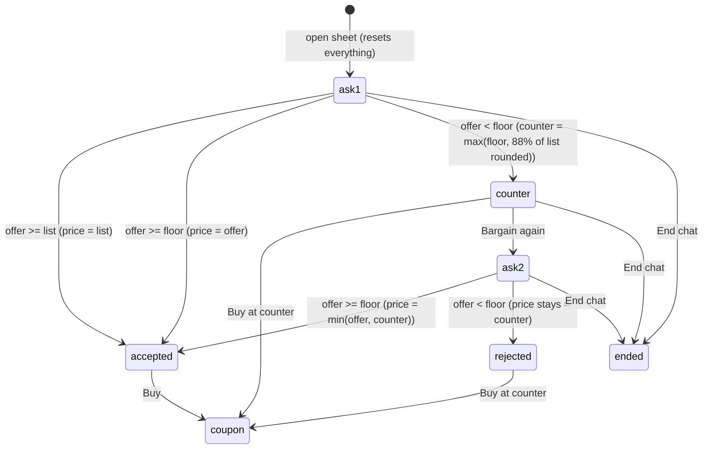

# Fayda — Prototype Audit

| | |
|---|---|
| **Status** | Draft v0.1 — for founder review |
| **Date** | 30 October 2026 |
| **Subject** | `Haggle_Interactive_App_v9.zip` (prototype branded "Haggle") |
| **Reference** | `FAYDA_PROJECT_FOUNDATION.md` v0.1 (feature inventory, bargaining rules R1–R17, decisions B1–B19, T1–T14) |
| **Author** | Founding technical architect |

**Status labels used throughout**

| Label | Meaning |
|---|---|
| ✅ **Implemented & verified** | Works as designed within the prototype's own scope; confirmed by running it |
| 🟡 **Implemented but incomplete** | Real logic exists, but it is partial, disconnected, or defective |
| 🎭 **Visual-only / simulated** | Looks functional but performs no real action, or fakes an outcome |
| ❌ **Missing entirely** | Required by Fayda scope; not present in any form |
| 🏭 **Production-only** | Needed for launch, not for the working prototype |

---

## 0. Executive summary

**What the prototype is.** A browser-only, single-user, multi-page HTML design prototype. It has 9 screens built with a design-tool template runtime (`*.dc.html` + generated `support.js` on React 18.3.1 UMD) and 4 hand-written HTML pages. It has no build system, no `package.json`, no backend, and no tests. State is held in component memory and two `localStorage` keys.

**Verdict.** The prototype is a strong **product and design reference**, but not a code base to extend.
- **Reusable:** the visual language, information hierarchy, flows, and microcopy.
- **Not reusable:** the code itself. It cannot run in React Native, cannot share state between a buyer and a seller, and keeps business rules in the client.

**Strengths to preserve**
1. A coherent, accessible visual system: Plus Jakarta Sans, orange `#C2410C` accent on near-black ink, 48–54 px touch targets, ARIA labels and pressed states.
2. The **Buy / Bargain CTA pair** on every product, which makes the differentiator obvious.
3. A bargaining UI that is conversational in presentation but structured in input: ₹ or % offer toggle, numeric validation, "Buy at ₹X / Bargain again" choices, end-negotiation confirmation that explains expiry, and a "deal locked" confirmation.
4. A one-screen seller publish flow with an easy pricing mental model: *Listed price* + *Lowest you'll accept*.
5. Seller onboarding that distinguishes business and individual sellers, with format validation and a Code of Conduct gate.
6. Trust features the foundation had deferred: verified-purchase reviews with seller replies, review voting, and order-linked problem reports.
7. A savings framing ("you save ₹299", "Total saved with Haggle") that reinforces the value of bargaining.
8. Hyderabad- and India-relevant seed catalogue (Bidriware, Kalamkari, Kolhapuris, kurtas) and ₹ formatting in `en-IN`.

**Critical gaps**
1. **No seller side of bargaining.** Every response comes from a client-side bot that speaks as the seller. Sellers never see, accept, or counter offers.
2. **Off-platform checkout model.** Deals end in a coupon for the seller's own website, or a WhatsApp message. This conflicts with the vision's on-platform purchasing and order management. It needs a founder decision (new **B20**).
3. **No connected data.** Published posts never reach the feed. A completed checkout creates no order. The agreed deal is lost before checkout (verified).
4. **Discovery is a card list with coloured placeholders.** There is no video, no full-screen reels, no product detail page, no search, no follow, and no saves.
5. **The confidential floor price ships in client JavaScript** and can be found by probing, because reopening the bargain sheet resets the attempt limit.
6. **Several flows are broken** in the delivered version (section 5). Examples: website-mode publishing throws an error; review and fraud submissions can never succeed.

**Recommendation.** Keep the design. Re-implement it on the agreed stack, following the foundation roadmap, ported screen by screen (section 12).

The first coding milestone is **M3.0 Foundation + Design System Port** (section 14): monorepo, API and database skeleton, and both Expo apps booting with a token-accurate port of the prototype's design primitives. No commerce screens are built in M3.0.

Before M3.1, the founder should decide **B20** (on-platform vs off-platform checkout), because it changes seller onboarding.

---

## 1. Scope and method

### 1.1 What was received

| File | Lines | Type | Role |
|---|---|---|---|
| `index.html` | 1 | Plain HTML | Demo harness: side menu + phone-frame iframe |
| `Main.dc.html` | 123 | Template | Sign in / sign up (phone OTP, Gmail OTP) |
| `Persona.dc.html` | 78 | Template | Buyer or seller choice |
| `BuyerAddress.dc.html` | 90 | Template | Shipping address |
| `Welcome.dc.html` | 57 | Template | Category picker |
| `Feed.dc.html` | 370 | Template | Product feed with category, comments, share, bargain sheets; profile drawer |
| `BargainChat.dc.html` | 184 | Template | Stand-alone bargain screen (older, hard-coded duplicate) |
| `SellerCheckout.dc.html` | 145 | Template | Simulated *seller's own website* checkout with coupon |
| `SellerOnboard.dc.html` | 199 | Template + inline JS | Seller details, checkout channel, Code of Conduct |
| `SellerStudio.dc.html` | 205 | Template + inline JS | New post, price range, coupon tiers |
| `Account.html` | 16 (minified) | Plain HTML/JS | Profile, orders, preferences, seller feedback, review/fraud modals |
| `SellerProfile.html` | 5 (minified) | Plain HTML/JS | Seller profile and reviews |
| `WhatsAppCheckout.html` | 1 (minified) | Plain HTML/JS | WhatsApp hand-off for individual sellers |
| `haggle.css`, `haggle.js` | 1 each | Shared | Styles, `localStorage` store, helpers for plain pages |
| `support.js` | 48 (45 KB) | Generated | Design-tool template runtime ("GENERATED … do not edit") |
| `vendor/react.js`, `vendor/react-dom.js` | — | Vendor | React / ReactDOM **18.3.1** production UMD |
| `README.md` | — | Doc | Version notes v6–v8 and stated limitations |

### 1.2 How it was verified

- **Source inspection** of every non-vendor file, including template bindings, component logic, inline scripts, and `localStorage` usage.
- **Execution** in headless Chromium (Playwright), served over local HTTP at a 390 × 844 viewport. Every page was loaded with console and page errors captured, and screenshots were taken.
- **Scripted journeys** covering about 45 checks: sign-up, buyer onboarding, feed interactions, bargaining (₹ and % modes, counter, second attempt, end chat), coupon checkout, seller onboarding, publishing (WhatsApp and website modes), reviews, votes, seller replies, preferences, drawer, and WhatsApp hand-off. Results are in Appendix A.

### 1.3 Limitations

- The sandbox has no internet access. Google Fonts failed to load, so screenshots use fallback fonts. WhatsApp and external links were confirmed to open the correct URL, but the destination was not reached.
- Not tested on a physical phone, in Safari/WebKit, or with assistive technology.
- `support.js` is a generated runtime. It was treated as a black box and not reviewed line by line, because it will not be reused.
- Visual judgements come from code values and screenshots, not from original design files. If Figma or similar source files exist, please share them (see section 15).

---

## 2. Technical assessment

### 2.1 Architecture as delivered

```
Browser (single user) ──► static HTML pages (navigated by <a href>)
                           ├─ *.dc.html: <x-dc> template + {{bindings}} + class Component extends DCLogic
                           │   rendered by support.js on window.React 18.3.1
                           ├─ plain pages: haggle.css + haggle.js (string-template rendering)
                           └─ state: component memory (lost on navigation) + localStorage
```

| Aspect | Finding |
|---|---|
| Build / tooling | None. No `package.json`, bundler, TypeScript, linting, or tests. |
| Dependencies | React and ReactDOM 18.3.1 (vendored UMD), generated design-tool runtime, Google Fonts CDN. |
| Styling | Inline styles on every element in templates; a separate global stylesheet for plain pages. |
| Navigation | Full page loads through links. The flow is linear, and there is no in-app tab bar or back-stack model. `index.html` provides demo navigation from outside the "phone". |
| State | Feed likes, comments, and bargain state live in memory only. Persistent keys: `haggle_app_v4` (`orders`, `reviews`, `reports`, `user`, `prefs`, `seller`, `posts`) and `haggle_onboarding_channel`. |
| Data model | Hard-coded `POSTS` array (16 items, 2 per category). Each item has `price` and `min` (the confidential floor). |
| Business logic | Entirely in the client: bargain acceptance, counter computation, coupon generation. |
| Multi-user | Not possible; buyer and seller cannot interact. |
| Media | No real media. Placeholders only. Review evidence is stored as base64 data URLs in `localStorage` (max 4 files of 450 KB). |
| Error handling | Mostly `alert()`. A few inline messages (bargain bot, coupon field). |
| Accessibility | Good intent: semantic buttons, `aria-label`, `aria-pressed`, labelled inputs, `role="dialog"`, Escape to close the drawer. Not tested with a screen reader. |
| Responsiveness | Templates are fixed 390 × 844 canvases, which is normal for design files. Plain pages are responsive up to 430 px. |

### 2.2 Code reusability

| Asset | Reusable in Expo/React Native? | Why |
|---|---|---|
| Template markup and runtime | **No** | Uses DOM/HTML elements and a proprietary template runtime; React Native has neither |
| Component logic (`renderVals`, handlers) | **Concepts only** | Rules must move to the backend; UI state maps to React hooks |
| Inline style values | **Yes, as design tokens** | Colours, radii, sizes, and type scale extracted in section 10.3 |
| Validation patterns (GSTIN, CIN, phone, HTTPS URL, offer input) | **Yes, as Zod schemas** | Must be corrected (section 5) |
| Copy and microcopy | **Yes** | Ported into an i18n string catalogue |
| Seed catalogue | **Yes** | Becomes seed data; needs real, rights-cleared media |
| SVG icons | **Yes, by style** | Paths appear Lucide-style (open-source licence). Use an icon package rather than copied paths (decision T15). |

**Conclusion:** expect a near-zero lift-and-shift of code and a high reuse of design. This was expected, and it is why the foundation recommends building the prototype in the production stack.

---

## 3. Inventory

### 3.1 Screens and states

| # | Screen (file) | States / sheets | Key elements | Persistence | Status |
|---|---|---|---|---|---|
| S1 | Sign in / up (`Main`) | start · Gmail · OTP | Sign in / Sign up segmented control, +91 phone, Send OTP, "Continue with Gmail", 6-digit OTP, resend text, Terms/Privacy | None | 🎭 Flow works; no verification or validation |
| S2 | Persona (`Persona`) | none · buyer · seller | Two selectable cards; Continue disabled until chosen | None | ✅ UI logic |
| S3 | Buyer address (`BuyerAddress`) | Home/Work/Other | Name, house, area, landmark, PIN, city, state, "Use my current location" | **Not saved** | 🎭 |
| S4 | Category welcome (`Welcome`) | 8 categories | Tinted tiles, "Show me {category}" | Not passed on | 🟡 Choice lost |
| S5 | Feed (`Feed`) | category sheet · share sheet · comments sheet · bargain sheet · end-confirm · coupon modal · profile drawer | Header with brand and category chip; cards with seller row, media placeholder, like/comment/share, title, price, Buy, Bargain | Memory only | 🟡 Core interactions work in session |
| S6 | Bargain chat (`BargainChat`) | offer · typing · final · ended · coupon | Seller header, product strip, chat bubbles, "Seller's offer … you save", Buy / Bargain | None | 🟡 Hard-coded duplicate of the S5 sheet |
| S7 | Seller website checkout (`SellerCheckout`) | product · checkout · done | Simulated third-party site, size picker, coupon Paste / Apply, totals, Pay | None | 🎭 Fixed product and code |
| S8 | Seller details (`SellerOnboard`) | company · individual; WhatsApp · website; Code of Conduct modal | Categories multi-select, company name, GSTIN, CIN, or name, address, map placeholder; checkout channel; Agree/Disagree | `localStorage` | ✅ Validation and gate / 🟡 rules |
| S9 | Seller new post (`SellerStudio`) | video · photo | Upload field, product name, category, caption, listed and lowest price with live range text, coupon tier manager, read-only checkout link, Publish | `localStorage` (no media) | 🟡 Defects D1, D2, D4 |
| S10 | WhatsApp hand-off (`WhatsAppCheckout`) | — | Editable "agreed price", opens `wa.me` with prefilled text | None | 🟡 Price is not trusted |
| S11 | My Haggle (`Account`) | Profile · Orders · Order detail · Preferences · Seller feedback · Review modal · Fraud modal | Editable profile, savings total, seeded orders, savings breakdown, star rating, review with mandatory photo + video, fraud report form, theme and seller-type preferences, seller reply editor | `localStorage` | 🟡 Defect D3 |
| S12 | Seller profile (`SellerProfile`) | reviews modal (sort) | Name, type, location, address, rating, two hard-coded posts | `localStorage` (reviews) | 🟡 Only the demo seller has data |
| S13 | Demo harness (`index`) | — | Side menu with 14 deep links into screens | — | Demo tool, not product |

### 3.2 Reusable UI patterns (component inventory)

| Pattern | Seen in | Port as `packages/ui` component |
|---|---|---|
| Brand lock-up (tag icon tile + wordmark) | S1, S5 | `BrandMark` (name from config, since the brand is not final) |
| Primary / dark / outline buttons, 48–54 px, radius 14 | All | `Button` (variants: `primary`, `dark`, `outline`, `danger-outline`) |
| Segmented control | S1, S8, S9 | `SegmentedControl` |
| Selectable card with icon tile | S2 | `ChoiceCard` |
| Chip / pill selector (single and multi) | S4, S5, S8, S9 | `Chip`, `ChipGroup` |
| Labelled text input with prefix (+91) | S1, S3, S8 | `TextField` (label, prefix, hint, error) |
| Bottom sheet with scrim | S5 sheets | `Sheet` |
| Confirmation dialog | S5, S6, S8 | `ConfirmDialog` |
| Chat-style timeline bubbles | S5, S6 | `NegotiationTimeline` (driven by structured offers) |
| Success modal with code block | S5, S6 | `DealAgreedCard` (re-purposed) |
| Product card (seller row, media, actions, title, price, CTA pair) | S5 | `FeedItemOverlay` / `ProductSummary` |
| Price-range card with live helper text | S9 | `BargainSettingsCard` |
| Order summary rows (subtotal, bargain discount, shipping, total) | S7, S11 | `PriceBreakdown` |
| Status pill | S11 | `StatusBadge` |
| Review card with seller reply and votes | S11, S12 | `ReviewCard` (if B22 is approved) |
| Savings highlight card | S11 | `SavingsCard` |
| Side drawer | S5 | Replace with tab bar + Profile tab |

### 3.3 Interactions inventory

| Interaction | Where | Status |
|---|---|---|
| Toggle sign in / sign up; phone → OTP; Gmail → email OTP; back | S1 | 🎭 (no validation; any or no code continues) |
| Pick persona → route to address or seller details | S2 | ✅ |
| Pick address type | S3 | ✅ (UI only; not saved) |
| Pick category → feed | S4 | 🟡 (feed ignores the choice) |
| Change category from feed | S5 | ✅ (filters the hard-coded list) |
| Like / unlike | S5 | 🟡 (session only) |
| Add comment (Enter or Post) | S5 | 🟡 (session only; author always "You") |
| Share → Copy link | S5 | 🎭 (label changes; nothing copied) |
| Share → WhatsApp, More apps | S5 | 🎭 (no handler) |
| Buy | S5 | 🎭 (opens `https://example.com/seller-store`) |
| Bargain: ₹ or % offer, validation, counter, second attempt, accept, end | S5, S6 | 🟡 (bot logic works; section 8) |
| Claim deal → coupon (copied to clipboard) → seller website | S5, S6 | 🟡 / 🎭 |
| Coupon Paste / Apply / Pay | S7 | 🎭 (accepts only `HGL-IT2200`) |
| Seller registration with validation → Code of Conduct → save | S8 | ✅ |
| Publish post | S9 | 🟡 (WhatsApp mode saves; website mode errors) |
| Profile edit / save | S11 | ✅ |
| Preferences save (theme, seller types) | S11 | 🟡 (theme partly applied; filter never applied) |
| Review submit, fraud submit | S11 | 🟡 (always rejected — D3) |
| Review vote, seller reply | S11 | ✅ (verified with a seeded review) |
| Seller rating average and review sort | S12 | ✅ |
| Profile drawer open / close / Escape | S5 | ✅ |
| WhatsApp hand-off | S10 | 🟡 (opens `wa.me`; price editable by buyer) |

### 3.4 User journeys

| # | Journey | Path | Verified result |
|---|---|---|---|
| J1 | New buyer onboarding | S1 → S2 → S3 → S4 → S5 | ✅ Navigates end to end. 🎭 No identity created, address not saved, category lost. |
| J2 | Returning user | S1 (Sign in) → S4 → S5 | ✅ Navigates. 🎭 No session. |
| J3 | Browse and engage | S5 like / comment / share / category | 🟡 Works in session; lost on reload. |
| J4 | Bargain → website checkout | S5 Bargain → counter → Buy → coupon → S7 → order placed | 🟡 Bargain works. ❌ **The agreed product, price, and coupon are replaced by a hard-coded kurta / `HGL-IT2200`.** The coupon from the bargain is rejected. No order is created. |
| J5 | Bargain → WhatsApp | S10 → `wa.me` | 🟡 Opens WhatsApp with text. ❌ The buyer can type any "agreed" price (₹1 accepted). |
| J6 | Seller onboarding → first post | S2 → S8 → Code of Conduct → S9 → Publish | 🟡 WhatsApp sellers can save a post. ❌ Website sellers cannot publish (D1). ❌ **The post never appears in the feed** (D4). |
| J7 | Post-purchase trust | S11 order → review / report → S12 rating → seller reply | 🟡 Votes, replies, and ratings work. ❌ New reviews and reports cannot be submitted (D3). |
| J8 | Preferences | S11 preferences → feed | 🟡 Saved. Dark mode is not applied to template screens; the seller-type filter is never applied. |

There is **no journey in which a seller acts on a buyer's offer**, and no journey from purchase to seller fulfilment.

---

## 4. Status classification

### 4.1 ✅ Implemented and verified (within prototype scope)

- Sign-in/sign-up UI state machine (start → phone or Gmail → OTP → next screen by mode).
- Persona selection with a disabled Continue button until a choice is made, and routing by persona.
- Category selection UI on Welcome, and category switching in the feed.
- Feed like toggle and comment posting (in session).
- Bargain sheet logic:
  - ₹ or % input, with rejection of non-numeric, zero, or ≥100% values.
  - "At or above list → buy at list".
  - Auto-accept at or above the floor.
  - Auto-counter at `max(floor, round(0.88 × list, ₹100))`.
  - One additional attempt, then the final price.
  - End-negotiation confirmation with an expiry explanation.
- Seller onboarding:
  - Business/individual toggle and category multi-select.
  - GSTIN (15 characters) and CIN (21 characters) format checks.
  - WhatsApp number (10–15 digits) and HTTPS URL validation.
  - Code of Conduct Agree/Disagree, persistence, and redirect.
- Seller Studio: live price-range validation and helper text ("up to N% off"); WhatsApp-mode publish saves a post record.
- Account: profile edit and persistence; seeded orders list and detail; savings calculation; preferences persistence.
- Review voting (toggle and switch), seller public reply, seller rating average, and review sorting.
- Profile drawer with Escape and backdrop close.

### 4.2 🟡 Implemented but incomplete

| Area | What exists | What is missing or broken |
|---|---|---|
| Feed | Category-filtered cards, engagement | Hard-coded data; new posts excluded; state lost on reload; preferences ignored; no pagination |
| Comments | Add and list | Not persisted; no author identity, seller replies, moderation, or deletion |
| Bargaining | Single-buyer bot negotiation | No seller participation, persistence, expiry, history, public offers, or limits across sessions (section 8) |
| Seller Studio | Single-screen post form | Media not stored; video *or* photos (not both); no variants, sizes, stock, bargaining mode, drafts, or preview; website mode broken |
| Seller onboarding | Validated form and conduct gate | CIN mandatory for all businesses; map and location non-functional; GSTIN not verified despite copy saying it is |
| Orders | Seeded list and detail | Checkout never creates orders; no statuses driven by a seller |
| Reviews and reports | Forms, rendering, votes, replies | Submission broken (D3); photo *and* video mandatory; reports go nowhere |
| Seller profile | Layout, rating | Only one seller has data; posts hard-coded; no follow |
| Preferences | Saved | Dark theme only on plain pages; seller-type filter never applied |
| WhatsApp hand-off | Link generation | Single hard-coded product; buyer-editable price |

### 4.3 🎭 Visual-only or simulated

- **Media:** every product video and photo is a tinted placeholder labelled "[Seller's product video]"; the play icon does nothing.
- **Authentication:** phone and email OTP accept anything (including nothing). "Resend code in 0:30" is static text. "Continue with Gmail" is an email form, not Google sign-in.
- **Location:** "Use my current location", "Drop pin on Google Maps", and the map embed are placeholders.
- **Share:** Copy link changes its label only; WhatsApp and More apps have no handler.
- **Buy:** opens `https://example.com/seller-store`.
- **Seller as bot:** buyers are told the seller "accepts" or "can do" a price and that the seller "replies instantly". No seller was involved.
- **Coupons:** "valid for 30 minutes, one use" is not enforced; the "Copied" badge always shows. The seller-defined coupon tiers from Studio are never used by the bargain flow, which generates its own `HGL-<initials><price>` code.
- **Payment:** "Pay & place order" on the simulated seller website shows a static success with `[ORDER ID]`.
- **Copy that promises unimplemented behaviour:** "We verify this with the GST portal", "Posted to your followers", "Welcome back, [First name]".
- **Trust and safety:** fraud reports are saved locally only; the enforcement policy (7-day suspension, then ban) is policy text, not logic.
- **Terms and Privacy:** `#terms` and `#privacy` anchors only.

### 4.4 ❌ Missing entirely (required for the Fayda prototype)

**Buyer app**
- Full-screen vertical reel playback (autoplay, mute, swipe).
- Product detail page with media gallery, variants/sizes, and stock.
- Search and filters (price, size, bargaining available).
- Follow seller, Following feed, saved items.
- "My offers" list across products, with status and countdown.
- Public offers.
- In-app notifications.
- On-platform checkout and simulated payment.
- Order tracking driven by seller status updates.
- Address management after onboarding, and sign-out.
- Tab-bar navigation.

**Seller app**
- Seller home / dashboard.
- **Negotiation inbox with accept / decline / counter.**
- Per-listing bargaining mode (fixed / private / public / both) and expiry.
- Separate auto-accept and auto-decline thresholds.
- Listing management (edit, pause, sold out, delete) and variants with stock.
- Multiple media per listing with upload and processing status.
- Order management (confirm, ship, deliver).
- Analytics and notifications.
- Profile editing after onboarding.

**Platform**
- Backend, shared database, multi-user identity, real-time updates, automated tests, build and CI, seed and reset tooling, environment labelling.

### 4.5 🏭 Production-only requirements (unchanged from the foundation, plus audit additions)

- Supabase phone OTP with SMS provider and DLT registration.
- Google sign-in, plus **Sign in with Apple** if any third-party login is offered on iOS.
- Cloudflare R2 and Stream.
- Payment gateway and settlement.
- Logistics.
- GSTIN verification and KYC.
- Location and maps services.
- Moderation, admin, and fraud investigation workflow with appeals.
- Push notifications and deep links.
- PostHog, Sentry, and OpenTelemetry.
- Account deletion; report/block for user-generated content.
- Legal pages and DPDP compliance.
- Store submission.

---

## 5. Verified defects

All defects except D17–D20 were reproduced in headless Chromium.

| # | Severity | Defect | Evidence / cause |
|---|---|---|---|
| D1 | High | **Website-mode sellers cannot publish.** Publishing throws `Cannot set properties of null (setting 'innerHTML')`. The coupon tier manager rendered in 0 of 5 page loads. With no onboarding record the default mode is website, so a new seller cannot publish at all. | Imperative script targets elements before or after the template runtime renders them |
| D2 | High | The checkout-link field in Studio is empty after onboarding, although publishing uses the correct link internally. | Same render race; the runtime re-render overwrites imperative DOM edits |
| D3 | High | **Review and fraud-report submissions always fail** with "Please upload at least one photo and one video", even with both attached. | `previewFiles` writes `window.uploadedMedia`; submit reads the script-scoped `let uploadedMedia`, which is a different binding |
| D4 | High | Published posts never appear in the buyer feed. | Feed renders a hard-coded `POSTS` array; Studio writes `haggle_app_v4.posts` |
| D5 | High | The agreed deal is lost: the checkout page is hard-coded to the kurta and `HGL-IT2200`, and the coupon produced by a feed bargain (e.g., `HGL-VA3300`) is rejected. | Constants in `SellerCheckout.dc.html` |
| D6 | High | Completing checkout creates no order; order history shows only the two seeded orders. | No write path |
| D7 | Medium | **The confidential floor price is shipped to the browser** (`min` in `POSTS`). Reopening the bargain sheet resets the attempt counter, so probing is unlimited. | Client-side rules; `openBargain` resets `phase` |
| D8 | Medium | WhatsApp hand-off lets the buyer state any "agreed" price (₹1 accepted) for a fixed product. | Editable input with an upper bound only |
| D9 | Medium | The category chosen on Welcome is not passed to the feed (Electronics chosen → Fashion shown). | Plain link with no parameter |
| D10 | Medium | Business onboarding requires a CIN, which excludes proprietorships and partnerships — likely the majority of Hyderabad boutiques. | Mandatory CIN validation |
| D11 | Medium | Seller-defined coupon tiers and the buyer bargain flow are disconnected. | Separate code generators |
| D12 | Low | "Show me{category}" renders with no space ("Show meFashion"). | Template whitespace |
| D13 | Low | No validation for phone length, email, OTP, or address fields (a 2-digit phone was accepted). | Missing checks |
| D14 | Low | The dark theme applies only to the plain HTML pages. | `applyTheme` is not used by templates |
| D15 | Low | Likes and comments are lost on navigation or reload; comments are always by "You". | Memory-only state |
| D16 | Low | Two bargaining implementations (S5 sheet and S6 page) diverge in copy and rules. | Duplicate code |
| D17 | Low | `alert()` is used for validation and confirmation on several screens. | UX inconsistency |
| D18 | Low | Fonts depend on the Google Fonts CDN, so the app is unbranded offline. | `<link>` to CDN |
| D19 | Low | Review evidence is stored as base64 in `localStorage` (about 5 MB browser limit). | Prototype constraint |
| D20 | Info | Template screens are fixed 390 × 844 canvases. | Expected for design output |

These are recorded for completeness. Fixing them in the HTML prototype is **not** recommended: the rebuild replaces this code.

---

## 6. Comparison with required Buyer and Seller experiences

Priority references are from the foundation inventory (P0 = working prototype).

### 6.1 Buyer app

| Required (Fayda) | Pri | Prototype | Status | Action |
|---|---|---|---|---|
| Phone OTP sign-in | P0 | S1 phone + OTP UI | 🎭 | Port S1 layout; dev OTP via API |
| Gmail / Google sign-in | — | "Continue with Gmail" (email OTP) | 🎭 | Decision B24; defer to P1 |
| Profile, addresses, settings | P0 | S3 (unsaved), S11 profile | 🟡 | Port S3 and S11 profile with validation and persistence |
| Reel feed (vertical, autoplay) | P0 | Card list with placeholders | ❌ | New full-screen reel feed reusing the S5 card hierarchy as overlay (B29) |
| Photo posts | P0 | Placeholder | 🎭 | Implement with real images |
| For You / Following | P0 | Category only | ❌ | New |
| Search, categories, filters | P0 | Category chip + sheet | 🟡 | Keep chip; add search and filters |
| Product detail | P0 | None (the S7 product view belongs to a simulated third-party site) | ❌ | New, in Fayda styling |
| Seller profile, follow | P0 | S12 (one seller), no follow | 🟡 | Port S12 layout; real data; Follow |
| Like / save / comment / share | P0 | Like, comment, share (partly fake); no save | 🟡 | Port; persist; add save; native share |
| Make / counter / accept / withdraw offers | P0 | Bot negotiation | 🟡 | Port the sheet UI onto the server negotiation engine |
| Public offers | P0 | None | ❌ | New |
| My offers | P0 | None | ❌ | New |
| Notifications | P0 | None | ❌ | New |
| Buy now / at agreed price, simulated payment | P0 | External site + coupon / WhatsApp | 🎭 | On-platform checkout (pending B20), reusing the S7 price-breakdown layout |
| Orders and tracking | P0 | Seeded list and detail with savings | 🟡 | Port S11 orders and detail; real status timeline |
| Reviews / ratings | not in foundation | Present (broken submit) | 🟡 | Decision B22 (recommend P0-lite) |
| Report a problem | P1 | Fraud report | 🟡 | Re-scope as "Report a problem" (B23) |
| Savings tracker | not in foundation | Present | ✅ | Keep (cheap, on-message) |
| Preferences (seller type, theme) | not in foundation | Present (partly applied) | 🟡 | Seller-type → feed filter (P0); dark mode → P2 |

### 6.2 Seller app

| Required (Fayda) | Pri | Prototype | Status | Action |
|---|---|---|---|---|
| Seller onboarding: individual / business | P0 | S8 | ✅ / 🟡 | Port; make CIN optional; address structured; drop checkout-channel fields if B20 = on-platform |
| Code of Conduct acceptance | — | S8 modal | ✅ | Keep; record version and timestamp server-side; policy text needs approval (B23) |
| Verification / KYC | P1 | Copy only | 🎭 | Show status "Not verified (prototype)" |
| Single publish flow | P0 | S9 | 🟡 | Port S9 as the base; add multi-media, variants and stock, bargaining mode |
| Drafts, edit, pause, sold out | P0 | None | ❌ | New "Listings" tab |
| Bargaining modes and private rules | P0 | Listed + lowest price only | 🟡 | Keep the simple model as default; advanced options (B21) |
| Negotiation inbox and responses | P0 | None (bot replies) | ❌ | New; most important missing screen |
| Inventory per variant | P0 | None (sizes exist only on the simulated website) | ❌ | New |
| Orders management | P0 | None | ❌ | New |
| Basic analytics | P0 | None | ❌ | New |
| Feedback inbox / replies | — | S11 Seller feedback | 🟡 | Port if B22 is approved |
| Notifications | P0 | None | ❌ | New |
| Coupon tier manager | — | S9 (broken) | 🟡 | **Retire** if B20 = on-platform |
| Website / WhatsApp checkout channel | — | S8, S9, S10 | 🟡 | Park (B20) |

---

## 7. UX assessment

### 7.1 Visual consistency

**Strong within template screens (S1–S9).** One typeface, a disciplined palette (ink `#111318`, muted `#5B6170`, accent `#C2410C`, borders `#D5D8DE` / `#E3E5E9`), consistent radii (12 px inputs, 14 px buttons and cards), and consistent control heights. The muted and accent colours both meet WCAG AA contrast on white.

**Inconsistent in the plain pages (S10–S12).**
- Buttons use smaller `13px system-ui` text and an 11 px radius.
- Emoji replace SVG icons (👤 🏬 📍 ⭐ 🚩).
- Headers use a text link "← Product feed" instead of an icon back button.
- Dark mode exists only here.
- `alert()` is used instead of inline feedback.

These read as a second product. The port should bring them into the template design language.

**The simulated seller website (S7)** intentionally uses a different look (serif, navy) to signal a third-party site. That is correct for the off-platform model and would disappear with on-platform checkout.

### 7.2 Usability

**Positive**
- Low-friction entry.
- Clear persona choice.
- Concise copy.
- The ₹/% offer toggle is an excellent fit for Indian bargaining habits.
- Savings are made visible.
- End-negotiation warns that the seller's offer will expire.
- Publishing fits on one scrollable screen with a sticky Publish button.

**Problems**
1. A **bot impersonating the seller** risks trust once users realise it. Automated replies should be attributed honestly (decision B30).
2. The **seller has to create up to 100 coupons per listing** in their own store (₹50 steps across the range). This is unworkable for small sellers and invites coupon leakage.
3. **Mandatory photo *and* video for every review** will suppress reviews.
4. **Business sellers without a CIN cannot register** (D10).
5. **Copy promises unimplemented actions** (GST verification, followers), which must not survive into a demo of "working" software.
6. "Last chance" after one counter may feel abrupt; the turn limit should be a configurable rule (R6), not hard-coded.

### 7.3 Navigation

- The demo depends on `index.html`'s side menu. Inside the "app", the only navigation is linear links plus a drawer that reaches Account pages. There is no way to reach Seller Studio, a seller home, or an order list from the feed, other than through the drawer's Account links.
- Persona switching ("You can switch later from your profile") assumes **one app with two modes**. Fayda has decided on **two apps**. That copy and the persona step become: the buyer app has no persona step; the seller app starts with business/individual onboarding. This is evidence for the foundation's risk #1 (two-app friction); the decision stays with you (B25).

**Proposed navigation** (to confirm at Gate G2):
- **Buyer tabs:** Home (reels) · Search · Offers · Orders · Profile.
- **Seller tabs:** Dashboard · Listings · Negotiations · Orders · Profile, plus a central "+ New listing".

### 7.4 Reel-discovery experience

The prototype's feed is an **Instagram-style scrolling card list**. It is not TikTok/Reels-style. Per card: seller row → square media → actions → title/price → Buy/Bargain.

| Dimension | Prototype | Required |
|---|---|---|
| Media | Placeholder only | Real video (MP4 in prototype, HLS in production) and photos |
| Layout | Card list, 2 items per category | Full-screen vertical paging, one item per screen |
| Playback | None | Autoplay muted, tap to unmute, pause off-screen, preload next |
| Content source | Hard-coded | Published listings, ranked, paginated |
| Engagement | Like, comment, share | + Save, Follow, double-tap like (optional) |
| Commerce | Buy (external), Bargain | Buy now, Make offer, product detail on tap, "Accepts offers" badge |

**Recommendation (B29).** Make Home a full-screen vertical reel feed. Preserve the card's information hierarchy as an overlay:
- Seller row with Follow at the top.
- Actions rail on the right.
- Title, price, and "Accepts offers" badge at the bottom.
- The **Buy / Bargain CTA pair kept as the primary bottom actions**.

Photo posts render as full-screen swipeable carousels in the same feed. The category chip stays in the header as a quick filter.

---

## 8. Bargaining analysis

### 8.1 State machine as implemented (client-side, per sheet opening)



**What it gets right:** two input modes; validation; offers at or above list redirect to buying at list; a bounded number of rounds; a clear "deal locked" outcome; an expiry message on exit.

**Structural problems**
1. The only actor is the bot; the seller never sees offers.
2. The floor price acts as both the auto-accept threshold and the counter floor, and it lives in the client.
3. There is no persistence, history, or identity.
4. The coupon is the "agreement", with no server record, deadline, or inventory hold.

### 8.2 Missing interactions and transitions (against foundation R1–R17)

| Missing | Rule | Needed for P0 |
|---|---|---|
| Seller receives offers in real time and **accepts / declines / counters** manually | R4 | Yes — core |
| Buyer **accepts a seller counter** as an explicit agreement record | R9 | Yes |
| Buyer **withdraws** a pending offer | R4 | Yes |
| **Time-based expiry** of pending offers with countdown | R7 | Yes |
| **Agreement with checkout deadline and reserved unit**; lapse on deadline | R9, R10 | Yes |
| **Invalidation** on sold out, pause, price drop, mode change | R11–R14 | Yes |
| **Convergence rule** for counters | R5 | Yes |
| Turn and attempt **limits that survive reopening** | R6 | Yes |
| Separate **auto-accept** and **auto-decline** thresholds; optional **auto-counter** | R8 | Yes (auto-counter per B21) |
| Listing **bargaining mode** (fixed / private / public / both) | R1, R15 | Yes |
| **Public offers** view (anonymised) | R15 | Yes (provisional) |
| Multiple buyers negotiating the same listing concurrently | R3, R17 | Yes |
| **Negotiation history** and an append-only event log | R16 | Yes |
| **Variant / size** in an offer | R3 | Yes |
| Agreed price **enforced server-side at checkout** | R10 | Yes |
| Notifications to both parties for every transition | — | Yes (in-app) |
| Honest attribution of automated responses | B30 | Yes |

### 8.3 What to keep from the prototype's bargaining UX

- **Timeline presentation**: offers rendered as bubbles, with system messages ("Offer expired", "Seller countered ₹2,200") between them. These are structured events, not free text.
- **₹ / % toggle**: the percentage is converted to an amount client-side for display only; the server receives the amount in paise.
- **Choice pair after a counter**: "Buy at ₹X" (accepts the counter and creates an agreement) or "Counter" (opens input with converging bounds shown).
- **End negotiation** confirmation, renamed "Withdraw / close negotiation", with expiry consequences.
- **"Deal locked" card**, re-purposed as "Offer accepted — buy at ₹X before 10:42 PM" with a Checkout button instead of a coupon.
- **Seller pricing card**: "Listed price" + "Lowest you'll accept" as the simple default, with live helper text. Copy changes to "Never shown to buyers".

---

## 9. Conflicts with the project vision

| # | Prototype assumption | Fayda vision / foundation | Recommendation |
|---|---|---|---|
| C1 | Fayda/Haggle is discovery + negotiation; **the transaction happens off-platform** (seller website coupon or WhatsApp) | On-platform purchasing and order management | Decide **B20**. Recommend on-platform checkout for the prototype; park off-platform hand-off. Off-platform makes orders, reviews, buyer protection, monetisation, and fraud handling unverifiable. |
| C2 | One app with buyer/seller persona switching | Two separate apps, shared identity | Keep two apps (approved stack); drop the persona screen; record B25 for post-beta review |
| C3 | Fully automated "bot seller" | Seller-controlled bargaining with optional automation | Seller inbox plus optional rules; honest attribution (B30) |
| C4 | Floor price in client data | Private rules never exposed | Server-side rules only (already designed) |
| C5 | Eight launch categories, including electronics | Fashion first, multi-category model | Seed fashion; keep the category model generic (B14) |
| C6 | Brand "Haggle" | Working name Fayda; brand open (B1) | Brand name as a config constant; neutral naming in code |
| C7 | Fraud enforcement policy stated in-product | Policies not assumed | Keep the Code of Conduct gate; treat policy text as draft pending approval (B23) |

---

## 10. Reuse plan

### 10.1 Retain / Change / Rebuild / Retire matrix

| Element | Decision | Notes |
|---|---|---|
| Visual language, tokens, typography | **Retain** | Port into `packages/ui` (10.3) |
| S1 Sign in layout (phone first) | **Retain** | Phone OTP only for the prototype; Gmail deferred (B24) |
| S2 Persona cards | **Change** | Pattern reused as `ChoiceCard` for Business / Individual in the seller app; persona step removed from the buyer app |
| S3 Address form | **Retain** | Add validation and persistence; geolocation P1 |
| S4 Category welcome | **Change** | Optional interests step, or skip; the feed chip remains the main control (decide at G2) |
| S5 Feed card hierarchy | **Change** | Becomes the reel overlay; Buy / Bargain pair retained |
| S5 Category / comment / share sheets | **Retain** | Port to `Sheet`; native share |
| S5 / S6 Bargain sheet | **Change** | Same look; server-driven negotiation; S6 duplicate retired |
| S7 Seller website checkout | **Retire** (if B20 = on-platform) | Reuse its `PriceBreakdown` layout in Fayda's own checkout |
| S8 Seller onboarding + Code of Conduct | **Retain / Change** | CIN optional; structured address; checkout-channel block removed if on-platform |
| S9 Seller Studio | **Change** | Base of the publish flow; add multi-media, variants and stock, bargaining mode |
| S9 Coupon tier manager | **Retire** (if B20 = on-platform) | — |
| S10 WhatsApp hand-off | **Park** | Possible later "Ask seller on WhatsApp" for pre-sale questions only, subject to B12 / B20 |
| S11 Profile, savings, orders, order detail | **Retain** | Restyled to template design language |
| S11 Reviews, votes, seller reply | **Retain** if B22 approved | Media optional; verified orders only |
| S11 Fraud report | **Change** | "Report a problem" tied to an order; admin handling P1 |
| S11 Preferences | **Change** | Seller-type filter → feed filter; theme → P2 |
| S12 Seller profile | **Retain** | Real data; Follow; listings grid |
| S13 Demo harness | **Retire** | Replaced by dev seed/reset and two real apps |
| Copy and microcopy | **Retain** | Into the i18n catalogue; remove unfulfilled promises |
| Seed catalogue | **Retain** | Fashion subset for the Hyderabad demo; needs rights-cleared media |
| All HTML/JS code and the template runtime | **Rebuild** | Expo / React Native and NestJS |

### 10.2 Copy worth keeping (examples)

"Shop it. Bargain it." · "Watch product videos, then buy or bargain directly with the seller." · "My price (₹) / Discount (%)" · "Buy at ₹X / Bargain" · "End this bargain? The seller's offer of ₹X will expire. You can still buy later at the listed price." · "Deal locked at ₹X" · "Price range for bargaining" · "Lowest you'll accept" · "Total saved with Haggle" · "Your savings".

### 10.3 Design tokens extracted (frequency-weighted from template inline styles)

| Token | Value | Usage |
|---|---|---|
| `color.ink` | `#111318` | Text, dark buttons, selected chips |
| `color.muted` | `#5B6170` | Secondary text |
| `color.accent` | `#C2410C` | Primary actions, focus, selection |
| `color.accentStrong` | `#9A3412` | Hover, accent text on tint |
| `color.accentTint` | `#FFF7ED` / `#FFEDD5` | Selected backgrounds, notices |
| `color.border` | `#D5D8DE` | Inputs, outline buttons |
| `color.divider` | `#E3E5E9` / `#EEF0F2` | Cards, separators |
| `color.surface` | `#FFFFFF` / `#F1F2F4` | Backgrounds, segmented track |
| `color.success` | `#047857` (tint `#DCFCE7`) | Success, savings |
| `color.danger` | `#B91C1C` | Errors |
| Category tints | `#FFEDD5 #DBEAFE #DCFCE7 #FCE7F3 #FEF3C7 #EDE9FE #CFFAFE #F1F2F4` | Category tiles |
| `radius` | 10 / **12** / **14** / 16 / 20 / 24 | Small / input / button-card / sheet / chip / large |
| `control.height` | 40 / 44 / **48** / 52 / 54 | Chip / icon button / standard / input / primary CTA |
| `font.family` | Plus Jakarta Sans 400–800 (open-source licence; bundle with `expo-font`) | All |
| `font.size` | 11 / 12 / **13** / **14** / **15** / 16 / 18 / 20–24 / 26–32 | Caption → display |

---

## 11. Prioritised gap analysis

| Priority | Gap | Why | Milestone |
|---|---|---|---|
| **P0-critical** | Shared backend, database, and identity so buyer and seller state is consistent | Two-sided journey is impossible without it | M3.0–M3.1 |
| **P0-critical** | Server-side negotiation engine + **seller negotiation inbox** | Core differentiator; currently bot-only | M3.3 |
| **P0-critical** | Listing model with variants and stock; publish → feed connection | Published posts go nowhere (D4) | M3.2 |
| **P0-critical** | On-platform checkout, simulated payment, order creation (pending B20) | Deal lost before checkout (D5, D6) | M3.4 |
| **P0** | Real media upload and playback; full-screen reels | Discovery is currently placeholders | M3.2, M3.5 |
| **P0** | Product detail page | Needed for variants, details, and offers | M3.2 |
| **P0** | Seller listings management, orders management, dashboard | Seller app currently has one screen | M3.2, M3.4, M3.7 |
| **P0** | Search, filters, follow, save, persistent likes and comments | Required buyer features | M3.5–M3.6 |
| **P0** | In-app notifications and real-time updates | Negotiation requires them | M3.3, M3.7 |
| **P0** | Validation, inline errors, loading and empty states; remove unfulfilled copy | "No fake screens" rule | Every milestone |
| **P0-lite** (if B22) | Reviews with optional media, seller replies | Prototype strength; trust | M3.6 |
| **P1** | Report a problem / report content, block | Store requirement; trust | M4.6 |
| **P1** | Google/Apple sign-in, geolocation, maps pin | Convenience | M4.2, M4.7 |
| **P2** | Dark mode, savings gamification, off-platform hand-off (if ever) | Nice to have | Post-launch |

---

## 12. Implementation plan: from prototype to a working application

This refines the foundation roadmap with the screen ports identified above. Nothing here starts before Gate G2 approval.

| Milestone | Prototype elements ported | New work |
|---|---|---|
| **M3.0 Foundation + design system** | Tokens (10.3), font, `Button`, `TextField`, `Chip`, `SegmentedControl`, `ChoiceCard`, `Card`, `Sheet`, `ConfirmDialog`, `StatusBadge` | Monorepo, CI, API and database skeleton, contracts, environment banner, design-system gallery |
| **M3.1 Identity and profiles** | S1 (phone OTP), S8 (business/individual, CIN optional, Code of Conduct), S3 (address) | Dev OTP auth, sessions, shared identity, buyer and seller profiles |
| **M3.2 Catalog, media, publishing** | S9 Studio (as base), price-range card, category chips | Multi-media upload-intent flow, variants and stock, bargaining mode and rules, drafts, product detail, simple feed |
| **M3.3 Bargaining** | S5 bargain sheet (timeline, ₹/% toggle, CTA pair, end confirm, deal card) | Negotiation engine and tests, seller negotiation inbox, expiry, auto rules, public offers, Socket.IO |
| **M3.4 Checkout and orders** | S7 `PriceBreakdown`, S11 orders list, order detail and savings | Checkout, reservations, simulated payment, order state machine, seller order management |
| **M3.5 Discovery** | S5 card hierarchy as reel overlay, category chip and sheet | Full-screen reels, ranking, Following, search, filters, seller profile (S12 layout) |
| **M3.6 Social and trust** | S5 comments and share, S11 / S12 review card, votes, seller reply (if B22) | Persistent likes and comments, follow, save, native share, reviews tied to orders |
| **M3.7 Notifications and analytics** | S11 savings card | Notification centres, seller dashboard and analytics |
| **M3.8 Hardening** | Seed catalogue (fashion subset) | Seed and reset, demo script, limitations, optional hosted demo |

**Coverage check:** after M3.8, every 🟡 and 🎭 item in section 4 is either implemented for real, retired by decision, or explicitly labelled as simulated (OTP, payment, fulfilment, verification).

---

## 13. Decisions raised by this audit

These extend the foundation list (B1–B19, T1–T14). None is assumed.

| # | Decision | Options | Recommendation | Needed by |
|---|---|---|---|---|
| **B20** | **Transaction ownership** | (a) On-platform checkout and orders (vision); (b) off-platform hand-off via seller website coupons or WhatsApp (prototype); (c) hybrid | **(a)** for the prototype and MVP; park (b) | **Before M3.1** |
| B21 | Bargaining automation offered to sellers | Auto-accept only; + auto-decline; + auto-counter (prototype behaviour) | Simple default ("Lowest you'll accept" = auto-accept); advanced: auto-decline and auto-counter price | G2 |
| B22 | Reviews and ratings in the working prototype | Include (P0-lite); defer to P1 | Include: verified orders only, stars + text, optional media, seller reply; votes optional | G2 |
| B23 | Code of Conduct and enforcement policy text | Prototype draft (7-day suspension, then ban) vs legal-reviewed policy | Keep the gate mechanism; mark text as draft until legal review | M4.6 (gate text by M3.1) |
| B24 | Sign-in methods | Phone OTP; + Google; + email OTP | Phone OTP for the prototype; add Google and Sign in with Apple together in P1 if wanted | M4.2 |
| B25 | Two apps vs one app with modes | Two apps (approved) vs one app | Keep two apps; revisit with beta data | Post-beta |
| B26 | Category onboarding step | Keep as interests step; remove | Remove for the prototype; the feed chip suffices | G2 |
| B27 | Buyer preference "show company / individual sellers" | Keep as feed filter; drop | Keep as a filter in Search, not a global setting | G2 |
| B29 | Home feed presentation | Full-screen reels; card list (prototype); both | Full-screen reels with the prototype's overlay hierarchy | G2 |
| B30 | Disclosure of automated seller responses | Disclose ("Auto-reply by seller's settings"); don't disclose | Disclose, without revealing thresholds | G2 |

| # | Technical decision | Recommendation |
|---|---|---|
| T15 | Icon set | Use an icon package matching the prototype's line style (e.g., Lucide for React Native, or Feather via the Expo-bundled icons). Compatibility to be verified at M3.0. |
| T16 | Fonts | Bundle Plus Jakarta Sans via `expo-font`; no runtime CDN dependency |
| T17 | Brand in code | Brand name, colours, and copy behind config and i18n keys, so "Haggle" or "Fayda" can be switched without a refactor |

---

## 14. Recommended first coding milestone: M3.0 Foundation + Design System Port

**Goal.** Establish the production-shaped skeleton and a faithful native port of the prototype's visual system, so every later milestone ports screens rather than inventing them.

**Not in scope.** No sign-in, feed, bargaining, or checkout screens. They would be mock-ups at this stage, which our rules forbid.

### Preconditions

1. Founder approval of this audit and of foundation items **T1, T2, T3, T5, T8, T14** (and **T15–T17** above).
2. An execution environment with network access, so dependencies can be installed and builds, linting, and tests verified. Recommended: Claude Code against a repository you own.
3. A new private Git repository under your (or the company's) account.

### Deliverables

- pnpm + Turborepo monorepo containing:
  - `apps/buyer` and `apps/seller` (Expo + Expo Router).
  - `apps/api` (NestJS + Fastify + Drizzle).
  - `packages/contracts`, `packages/api-client`, `packages/ui`, `packages/app-core`, `packages/config`.
- Docker Compose PostgreSQL, a Drizzle migration pipeline, and `.env.example` files.
- API endpoints:
  - `GET /v1/health` (application and database status).
  - `GET /v1/meta` (environment, app version, provider list with `simulated` flags).
  - OpenAPI JSON generated from the Zod contracts.
- `packages/ui` with prototype tokens, the bundled font, and the components listed for M3.0 in section 12. Each component has loading, disabled, and error variants where relevant.
- Each app shows two real screens:
  1. **Environment status**: calls `/v1/meta` through the typed client and TanStack Query, with loading, error-with-retry, and success states.
  2. **Design-system gallery** (dev-only), rendering every primitive in all variants.
- Persistent "PROTOTYPE · simulated services" banner in both apps.
- Separate dev app names and bundle identifiers for buyer and seller, so both install on one device.
- GitHub Actions CI running install, typecheck, lint, and tests.
- Documentation:
  - `README` with setup, commands, and environment variables.
  - `TECH_STACK.md` with exact verified versions.
  - Initial `ARCHITECTURE.md`, `DECISIONS.md`, `PROGRESS.md`, and `PROTOTYPE_AUDIT.md` (this document).

### Acceptance criteria

| # | Criterion | How verified |
|---|---|---|
| A1 | From a clean clone, `pnpm install` succeeds with no peer-dependency errors | Fresh clone in CI and locally |
| A2 | `pnpm typecheck`, `pnpm lint`, and `pnpm test` pass at the root with strict TypeScript; CI is green on the first pull request | CI logs |
| A3 | `docker compose up -d` and `pnpm db:migrate` succeed; `pnpm dev:api` serves `/v1/health` returning `db: "up"`, and returns `db: "down"` with HTTP 503 when the database is stopped | Integration test against real Postgres + manual check |
| A4 | `/v1/meta` responses validate against the shared Zod contract; the OpenAPI document is generated from the same schema | Contract test |
| A5 | Buyer and seller apps launch on an Android device or emulator **and** an iOS simulator (Expo Go or development build), side by side on one device, with distinct names | Screenshots / screen recording in `PROGRESS.md` |
| A6 | The status screen shows loading, then success with API data; with the API stopped it shows an error state with a working Retry | Manual test, recorded |
| A7 | Gallery components match prototype tokens exactly (colours, radii, heights, font) and are visually comparable side by side with the prototype screenshots for Button, TextField, Chip, SegmentedControl, ChoiceCard, and Sheet | Side-by-side screenshots attached to `PROGRESS.md` |
| A8 | The font is bundled (works offline); no runtime CDN requests | Airplane-mode check |
| A9 | Money formatting utility (`₹` en-IN from integer paise) and contract schemas have unit tests | Test report |
| A10 | No screen implies functionality that does not exist; the gallery is reachable only in development builds | Review checklist |
| A11 | All library versions are recorded and confirmed compatible with the chosen Expo SDK; no unapproved dependencies added | `TECH_STACK.md` review |
| A12 | No secrets committed; `.env.example` documents every variable | Secret scan in CI |

**Exit:** founder review of the recording, screenshots, and CI run → proceed to M3.1 (Identity and profiles), after **B20** is decided.

---

## 15. What would improve this audit (optional)

- Original design source files (e.g., Figma), if any, to confirm intended spacing, states, and any screens not in the ZIP.
- Earlier versions (v1–v8) only if they contain flows removed from v9 that you want to keep.
- Any feedback from sellers or buyers who used this prototype, especially on the coupon/WhatsApp model and the bot negotiation.
- Real product photos and videos you have the rights to use, for the Hyderabad seed data.

---

## Appendix A — Verification log (headless Chromium, 390 × 844, offline)

| Check | Result |
|---|---|
| All 13 pages load without JavaScript errors (only Google Fonts requests fail offline) | PASS |
| Sign-up accepts a 2-digit phone and proceeds to OTP | PASS (no validation) |
| "Verify & continue" proceeds without any code | PASS (simulated) |
| Persona buyer → address; empty address accepted; nothing saved to storage | PASS (simulated) |
| Welcome category carries to feed | **FAIL** (D9) |
| Like increments count; comment posts | PASS |
| Likes and comments persist after reload | **FAIL** (D15) |
| Share "Copy link" changes label | PASS (no copy; other share buttons inert) |
| Low offer on earbuds (list ₹3,999, floor ₹3,299) → counter ₹3,500 | PASS |
| Second offer ₹3,300 accepted | PASS (floor reachable by probing; D7) |
| Coupon generated (`HGL-VA3300`) | PASS |
| Seller checkout shows the bargained item and coupon | **FAIL** (hard-coded kurta / `HGL-IT2200`; D5) |
| Bargain coupon accepted at checkout | **FAIL** (D5) |
| Order placed screen | PASS (static, `[ORDER ID]`) |
| New order appears in history | **FAIL** (D6) |
| 15% discount mode: ₹2,124 auto-accepted | PASS |
| End-chat confirmation | PASS |
| Company registration → Code of Conduct → Seller Studio | PASS |
| Business registration without CIN | Blocked (D10) |
| Studio checkout link prefilled from onboarding | **FAIL** (D2) |
| WhatsApp-mode publish saves a post (no media) | PASS |
| Website-mode publish | **FAIL** (TypeError; coupon manager rendered 0/5 loads; D1) |
| Published post appears in feed | **FAIL** (D4) |
| Review with photo + video submits | **FAIL** (D3) |
| Review vote toggles (seeded review) | PASS |
| Seller reply publishes; seller rating average updates | PASS |
| Dark theme applies to feed | **FAIL** (D14) |
| Profile drawer opens and closes | PASS |
| WhatsApp hand-off with agreed price ₹1 | Allowed (D8); opens `wa.me` |

## Appendix B — Prototype data stores

- `haggle_app_v4`: `{ user, prefs{theme, company, individual}, seller{name, type, mode, phone, url, checkoutLink, address, categories, codeOfConductAgreed}, orders[], reviews[], reports[], posts[] }`
- `haggle_onboarding_channel`: `{ kind, categories, name, gstin?, cin?, address?, mode, phone?, url?, checkoutLink, codeOfConductAgreed, acceptedAt }`
- `POSTS` (in `Feed.dc.html`): `{ id, cat, seller, title, price, min, video, tint, likes }` × 16. **`min` is confidential and must never be client-side.**
